<div align="center">
  <a href="https://github.com/Arc-Jung/ezzzk/releases">
    
  </a>
</div>

# 이지직 - 치지직 개선 익스텐션 — ezzzk

> ℹ️ 이 확장은 **네이버·치지직이 만들거나 후원하지 않은 비공식 서드파티 도구**입니다.
> `치지직`·`CHZZK` 는 네이버의 상표이며, 이 프로젝트는 해당 상표와 제휴 관계가 없습니다.

치지직(chzzk.naver.com) 시청 경험을 개선하는 **Chrome / Edge 확장 프로그램**.
매 방송 진입마다 반복하는 수동 조작(화질 선택, 음소거 해제, 볼륨 맞추기, 넓은 화면 전환, 채팅창 폭 조절)을 자동화하고,
자주 쓰는 채팅과 설정 조합을 저장해 두었다가 즉시 불러 쓸 수 있게 한다.

- 지원: **데스크톱 Chrome / Edge**, 안드로이드는 **Edge Canary 만** (Dev·Beta·Stable 은 확장 미지원). **iOS 제외**
- 설계 우선순위: **모바일·태블릿 10인치급 우선**. 요구가 충돌하면 모바일·태블릿을 채택한다.
- 설정·시청 정보는 외부 서버로 보내지 않는다. 설정창에서 GitHub의 공개 최신 릴리스 정보만 조회한다. 모든 설정은 `chrome.storage.local` 에만 저장하고 권한은 `storage` 하나만 쓴다.

---

## 스크린샷

[자막형 채팅 사용법·검증 화면](screenshots/chat-subtitle.md) · [전체화면 채팅 입력](screenshots/fullscreen-chat.md) · [클린봇 켜기·끄기](screenshots/cleanbot.md)

[갤럭시 Z 폴드8·폴드8 울트라 화면별 검증과 스크린샷](screenshots/fold8.md)

### 노트북 13인치 (1440×900)

| 화면                                                                                              |                                                                |
| ------------------------------------------------------------------------------------------------- | -------------------------------------------------------------- |
| 기본 시청 — 채팅 부가 요소 숨김 + 컨트롤바에 `멀티`·`⚙` 버튼 삽입, 플레이어 우측 중앙에 `+ − ⟩ ▦` | 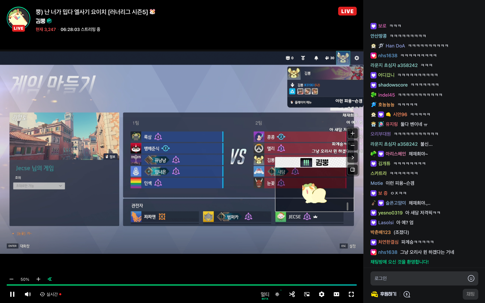              |
| 설정 패널 (FR-09.2) — 탭 8개 (마지막이 오픈소스 라이선스 고지)                                    | 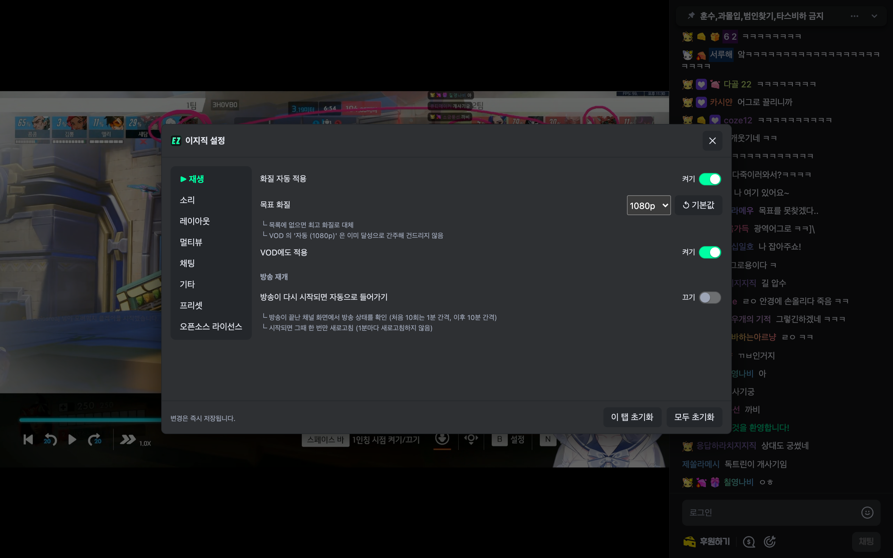           |
| 멀티뷰 구성 시트 (BETA) — 조작은 상단, 인기 방송 30개씩 추가 로드                                 | 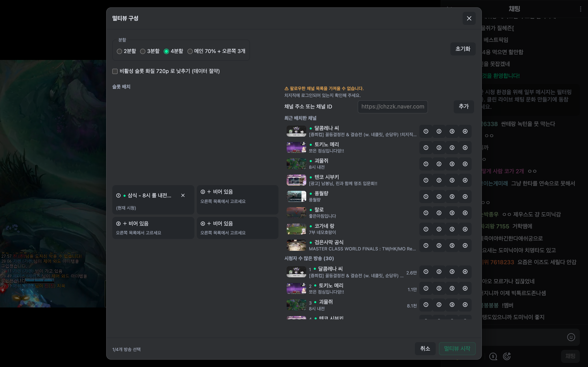 |
| 멀티뷰 시청 (BETA) — 4분할                                                                        | 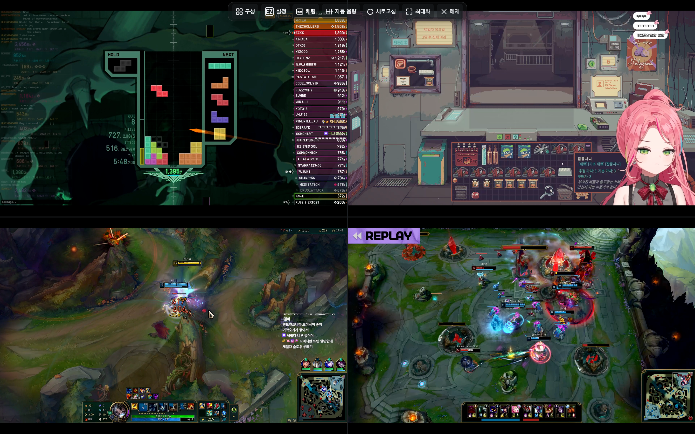        |
| 멀티뷰 시청 (BETA) — 메인 70% + 오른쪽 3개 | 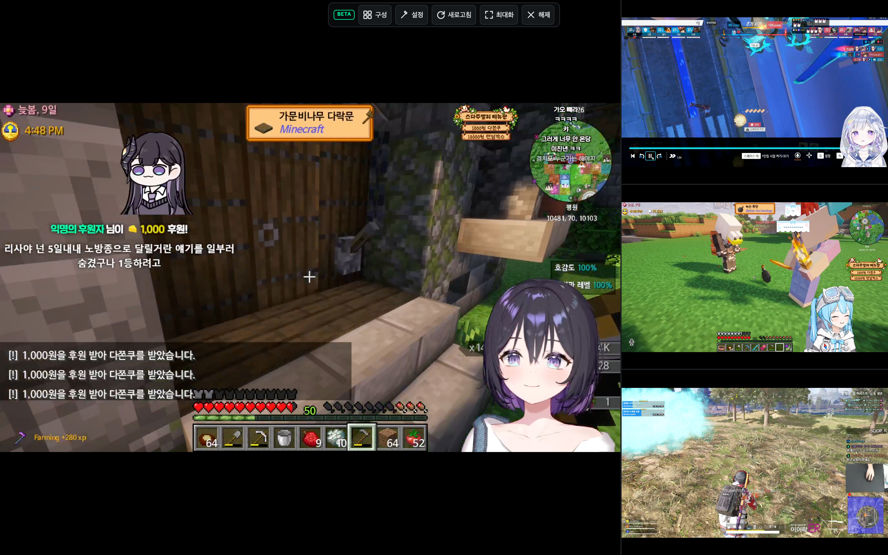 |

### 모바일 (데스크톱 사이트 요청 상태)

| 화면                                                               |                                                                                    |
| ------------------------------------------------------------------ | ---------------------------------------------------------------------------------- |
| 가로 915×412 — 기본 시청 (FR-10 초광폭 적용)                       | 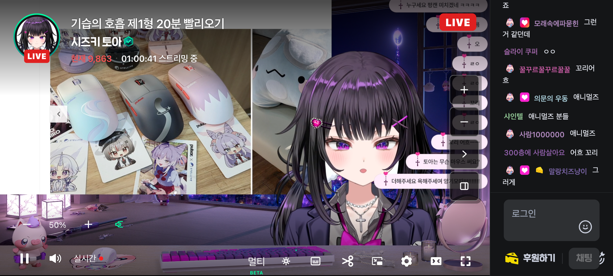                   |
| 세로 412×915 — 기본 시청 (**채팅이 영상 아래로 내려간 하단 배치**) | 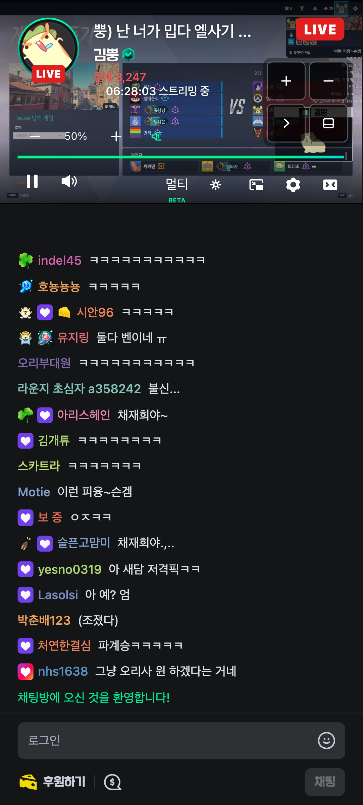                    |
| 가로 915×412 — 설정 패널                                           | 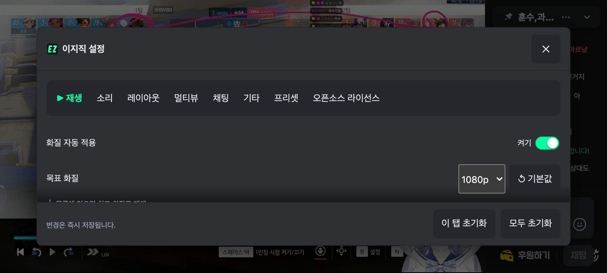                |
| 세로 412×915 — 설정 패널                                           | 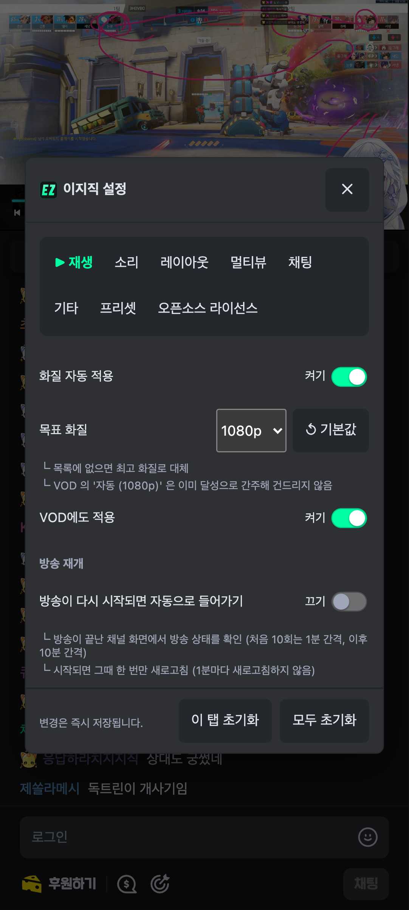                 |
| 가로 915×412 — 멀티뷰 구성 (4분할까지)                       | 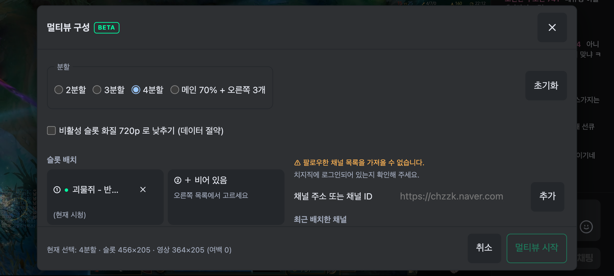 |
| 세로 412×915 — 멀티뷰 구성 (4분할까지)                       | 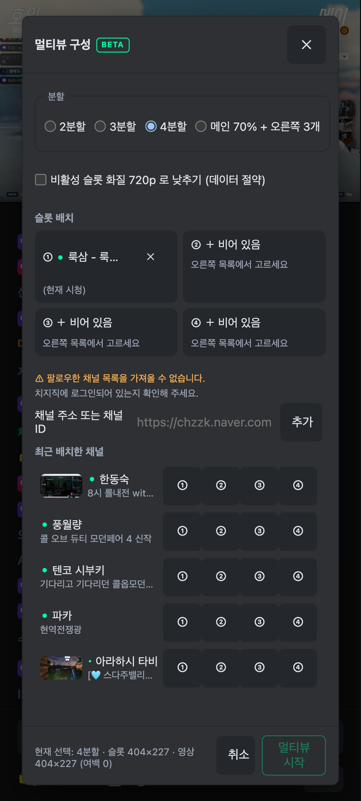  |
| 가로 915×412 — 멀티뷰 시청 (4분할 · 2×2)                       | 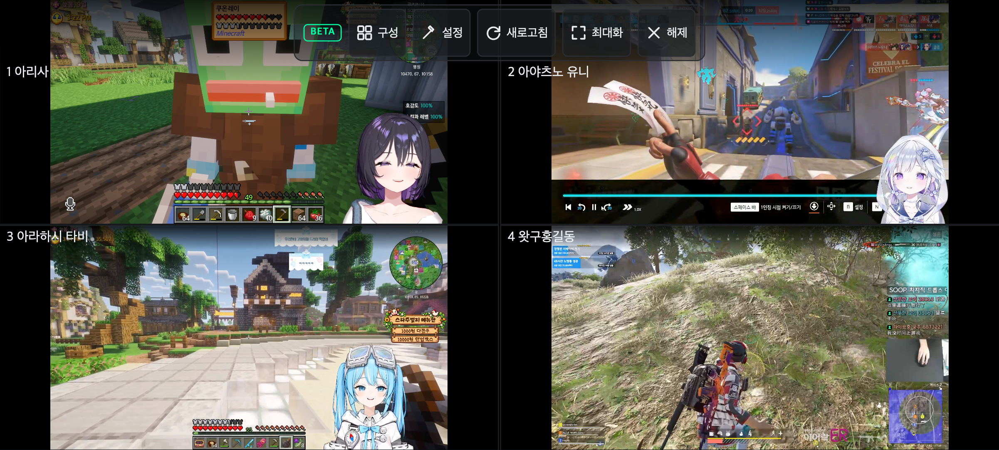             |
| 가로 915×412 — 메인 70% + 오른쪽 3개 | 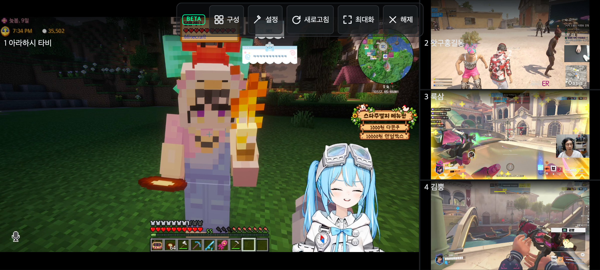 |
| 세로 412×915 — 멀티뷰 시청 (4분할 · 한 열)                       | 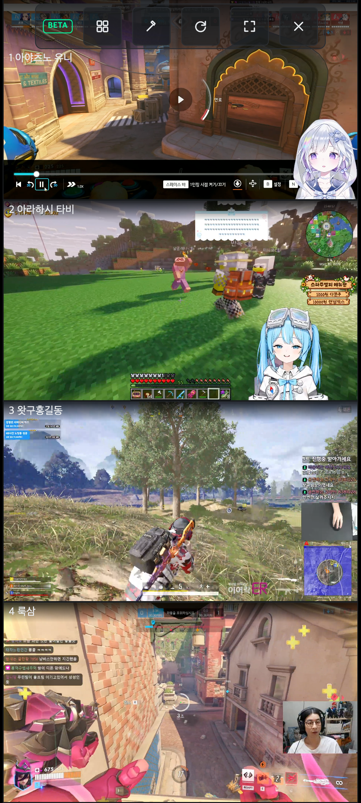              |

> ℹ️ `멀티` 버튼은 이전에 보던 구성이 있으면 그대로 이어서 연다 (구성을 바꾸려면 스테이지의 `구성`).
> **슬롯·사이드 채팅 기능은 버그로 임시 비활성**이며, 멀티뷰는 아직 **베타**다.

멀티뷰 구성에서 **메인 70% + 오른쪽 3개**를 선택하면 1번 방송을 왼쪽 가로 폭의 약 70%에 크게, 2~4번 방송을 오른쪽 30%에 세로로 배치합니다. 선택한 배치는 저장되며, 세로 화면에서는 기존 한 열 배치를 사용합니다.

## 기능

| ID      | 기능                                                   | 비고                                                                                                                                                                                                                   |
| ------- | ------------------------------------------------------ | ---------------------------------------------------------------------------------------------------------------------------------------------------------------------------------------------------------------------- |
| FR-01   | 1080p 화질 자동 선택                                   | 목록에 없으면 최고 화질로 대체. VOD 도 적용                                                                                                                                                                            |
| FR-02   | 음소거 자동 해제 + 기본 볼륨 50%                       | 브라우저 자동재생 정책상 최초 클릭까지 미뤄질 수 있다                                                                                                                                                                  |
| FR-03   | `+` / `-` 볼륨 조절 (기본 10% 단위)                    | 증감 폭 5 / 10 / 20% 선택                                                                                                                                                                                              |
| FR-03.2 | **볼륨 100% 초과 증폭 (최대 200%)**                    | `video.volume` 은 0~1 이라 Web Audio 게인으로 올린다. 100% 초과는 **주황색**, 150% 초과는 찢어짐 경고로 **빨간색**                                                                                                      |
| FR-03.3 | **방송(채널)별 마지막 볼륨 기억**                      | 채널마다 마지막으로 맞춘 볼륨을 브라우저 `localStorage` 에 저장해 다음 진입 때 자동 적용. 멀티뷰는 화면마다 그 채널의 값. 저장값이 없는 채널은 기본 볼륨. VOD 는 대상 아님 |
| FR-19   | **음량 평탄화(오디오 컴프레서)**                       | **기본 켜짐.** 방송마다 다른 음량을 눌러 균일하게. 구현은 chzzk-plus(MIT) 참조                                                                                                                                         |
| FR-04   | 자주 쓰는 채팅 저장·바로 쓰기                          | 🚫 **버그로 임시 비활성 (2026-08-23, 재작업 예정).** 설정에서 고를 수 없고 저장값과 무관하게 표시되지 않는다                                                                                                            |
| FR-05   | 채팅창 점유율 조절 (15~50%)                            | 기본은 **플레이어 우측 중앙에 `+ − ⟩ ▦` 상시 세로 배치**. 도구 행 폴백(좁은 화면)에서만 `↔` 토글로 접힌다. 클릭당 이동폭 1 / 2 / 5 / 10% 선택(기본 2%). 세로 자세에서는 채팅이 **영상 아래**로 간다                     |
| FR-06   | 통나무(파워) 자동 수집                                 | **기본 끄기.** 쓰려면 설정에서 직접 켠다                                                                                                                                                                               |
| FR-07   | 자동 넓은 화면                                         | VOD 도 적용                                                                                                                                                                                                            |
| FR-08   | 옵션 프리셋 저장·불러오기                              | 최대 20개. 기본 3종(기본 · 채팅 집중 · 영상 집중) 제공                                                                                                                                                                 |
| FR-09   | 확장 팝업 + 페이지 내 세부 설정 패널(탭 8개)           | 변경 즉시 저장, 열린 모든 탭에 반영                                                                                                                                                                                    |
| FR-10   | 초광폭 가로 모드 (16:9 무잘림 + 잔여 폭 채팅)          | 뷰포트 가로세로비 **1.8 이상**에서 자동 적용(1.76 미만이면 해제 — 임계값 깜빡임 방지). 영상을 **왼쪽/가운데** 중 선택(기본 왼쪽)                                                                                        |
| FR-11   | 특정 유저 채팅만 표시                                  | 복수 선택 가능. 켜는 즉시 최근 200개에서 과거 발언 채움                                                                                                                                                                |
| FR-12   | 기기 유형별 최적 UI·UX                                 | 데스크톱 / 노트북 / 태블릿 13"·10"·7" / 모바일 6종                                                                                                                                                                     |
| FR-13   | 치트키 구매 팝업 가리기                                | 프로모션 팝업 UI(배너 + 플레이어 툴팁)를 가린다                                                                                                                                                                        |
| FR-14   | 2~4 화면 분할 동시 시청(멀티뷰)                        | 모든 슬롯이 소리를 낸다. 슬롯마다 자기 컨트롤바에 싱글뷰와 같은 볼륨·컴프레서 버튼이 뜬다. 슬롯·사이드 채팅은 버그로 임시 비활성. 스테이지 조작 바(`구성 설정 최대화 해제`)는 가운데 상단, 멀티뷰 전용 기능만 담당한다 |
| FR-15   | 채팅 폰트 크기 조절                                    | 사이드 11–24px(기본 14) · 슬롯 10–16px(기본 12)                                                                                                                                                                        |
| FR-16   | 채팅창 부가 요소 숨김                                  | `채팅` 헤더 · 주간 후원 랭킹 · 드롭스 안내 · 무료 치즈 받기 툴팁 · 클린 라이브 필터링 안내 · 로그인 안내 문구. **기본 숨김**, 항목별 토글                                                                              |
| FR-17   | 채팅창 광고 배너 숨김                                  | **기본 숨김**. 배너 UI 만 가린다 — 영상 광고 재생에는 개입하지 않는다                                                                                                                                                  |
| FR-18   | 광고 `SKIP` 버튼 자동 클릭                             | **기본 켜기**. 스킵 버튼이 나타나면 대신 눌러 준다 (92초 광고에서 75.8초 절약 실측)                                                                                                                                    |
| FR-18.2 | `광고 차단 프로그램을 사용 중이신가요?` 안내 자동 확인 | FR-18 과 같은 토글. 문구로만 판정하고 `자세히 보기` 링크는 누르지 않는다                                                                                                                                               |
| —       | 치지직 내장 클린봇 자동 끄기                           | **기본 끄기.** 켜면 계정 설정의 클린봇 토글 자체를 끈다(자체 필터를 만드는 것이 아니다). 이미 꺼져 있으면 건드리지 않는다                                                                                               |
| —       | 재생 실패 자동 재시도                                  | 스트림을 한 번도 받지 못한 채 검은 화면만 남으면 영상을 다시 불러온다(최대 2회). 멀티뷰 슬롯도 같은 재시도를 갖는다                                                                                                     |

### 페이지별 지원 범위

| 페이지                                     | 지원                                                                                                                                                                                   |
| ------------------------------------------ | -------------------------------------------------------------------------------------------------------------------------------------------------------------------------------------- |
| 데스크톱 라이브 (`chzzk.naver.com/live/…`) | 전부. **멀티뷰는 이 페이지에서만** 열린다                                                                                                                                              |
| VOD (`chzzk.naver.com/video/…`)            | 화질·볼륨·넓은 화면·설정 패널 + 광고 스킵·프로모션 숨김·재생 실패 재시도 (채팅 관련 기능은 대상이 없다)                                                                                |
| 모바일 웹 (`m.chzzk.naver.com`)            | **화질·볼륨** + 광고 스킵·프로모션 숨김·재생 실패 재시도. 채팅 UI·넓은 화면 버튼이 아예 없어 관련 기능과 세부 설정 패널은 동작하지 않는다(팝업은 쓸 수 있다). 진입 시 안내를 1회 노출한다 |

> 모바일에서 채팅과 함께 보려면 브라우저의 **"데스크톱 사이트 요청"**을 켜면 된다.
> 그 상태에서 가로로 돌리면 FR-10 이 자동 적용된다.
>
> ⚠️ **확장이 데스크톱 사이트로 자동 전환해 주지는 못한다.** 모바일 UA 로 접속하면 치지직이
> `m.chzzk` 로 다시 보내 확장이 리다이렉트하면 무한 루프가 되기 때문이다. 대신 안내를 1회 노출한다.

---

## 단축키

| 동작                  | 단축키                                |
| --------------------- | ------------------------------------- |
| 볼륨 올리기 / 내리기  | `Shift + ↑` / `Shift + ↓`             |
| 멀티뷰 열기 / 닫기    | `Alt + M`                             |
| 멀티뷰 초점 슬롯 전환 | `Alt + Shift + 1` ~ `Alt + Shift + 4` |
| 세부 설정 패널        | `Alt + ,`                             |

> 치지직 네이티브 단축키 `space` · `k`(재생/일시정지) · `m`(음소거) · `f`(전체화면) 는 **쓰지 않는다.**
> 태블릿 7인치급·모바일에서는 단축키를 비활성한다.
>
> ℹ️ 채팅 프리셋 단축키(`Alt + 1` ~ `Alt + 9`)는 FR-04 가 임시 비활성이라 지금은 동작하지 않는다.

---

## 개발

Node.js **24.18.0** 고정(`.nvmrc`), 패키지 매니저는 **yarn**.

```bash
nvm use            # 24.18.0
yarn install
yarn dev           # 개발 빌드 (watch)
yarn build         # 프로덕션 빌드 → dist/
yarn typecheck     # tsc --noEmit
yarn lint          # ESLint
yarn format        # Prettier 적용
yarn format:check  # Prettier 검사 (CI 가 돌린다 — 커밋 전에 함께 확인한다)
yarn test          # 유닛·통합 테스트 (vitest)
```

### 설치 (스토어 등록 전 · 개발자 모드)

확장 폴더를 만드는 방법이 둘이고, **로드하는 절차는 같다.**

**1단계 — 폴더 만들기 (둘 중 하나)**

| 방법 | 절차 | 확장 폴더 |
| --- | --- | --- |
| 릴리스 ⭐ | [Releases](https://github.com/Arc-Jung/ezzzk/releases) 에서 `ezzzk-<version>.zip` 을 받아 압축을 푼다 | 압축을 푼 폴더 |
| 직접 빌드 | `nvm use && yarn install && yarn build` | `dist/` |

> 릴리스에는 `.crx` 도 올라가지만 크롬·엣지가 스토어 밖 `.crx` 설치를 차단하는 경우가 많다.
> `.zip` 에는 그 차단이 없다.

**2단계 — 로드하기**

| 단계 | Chrome | Edge |
| --- | --- | --- |
| 1 | 주소창에 `chrome://extensions` | `edge://extensions` |
| 2 | 우측 상단 **개발자 모드** 켜기 | 좌측 하단 **개발자 모드** 켜기 |
| 3 | **압축해제된 확장 프로그램을 로드** | **압축을 풀린 항목 로드**(Load unpacked) |
| 4 | 1단계에서 만든 폴더 선택 (`manifest.json` 이 **바로 안에** 있어야 한다) | 동일 |
| 5 | `https://chzzk.naver.com` 접속 | 동일 |

🔴 **폴더를 지우거나 옮기면 확장이 비활성된다.** 지워지지 않는 경로에 둔다.

**확인** — 확장 목록에 `이지직` 과 버전이 보이고, 치지직 라이브 페이지 컨트롤바 우측에
`멀티` · `⚙*` 버튼이 뜬다. 툴바에 아이콘이 없으면 퍼즐 조각(확장) 아이콘 → `이지직` 핀 고정.

> 릴리스는 자동이다 — `main` 에 머지되어 CI 가 통과하면 패치 버전이 `0.0.1` 오르고
> 태그·릴리스가 만들어진다.

---

### 수동 설치 — Edge Canary for Android (모바일)

> 🔴 **안드로이드에서 확장을 쓸 수 있는 브라우저는 Edge Canary 하나뿐이다** (2026-09-08 확인).
> **Dev 채널은 확장을 지원하지 않는다** — 예전에는 됐지만 지금은 안 된다. 정식(Stable)·Beta 도
> 마찬가지다. iOS 는 크롬·엣지 모두 확장을 지원하지 않아 **대상이 아니다.**

**절차**

1. Play 스토어에서 **Microsoft Edge Canary** 설치
   - https://play.google.com/store/apps/details?id=com.microsoft.emmx.canary
2. **기기에서 바로** [최신 릴리스](https://github.com/Arc-Jung/ezzzk/releases/latest) 를 열어
   `ezzzk-<version>.zip` 을 받는다. 이 zip 이 곧 빌드 산출물이라 **직접 빌드할 필요가 없다.**
   - 안드로이드 Edge Canary 로 위 링크를 열고 자산을 탭하면 `Download/` 에 저장된다
   - PC 에서 받아 옮기려면 USB 파일 전송·클라우드 드라이브, 또는
     ```bash
     adb push ~/Downloads/ezzzk-*.zip /sdcard/Download/
     ```
3. Edge Canary 에서 `⋯` 메뉴 → **설정** → **정보**(About) 에서 빌드 번호를 여러 번 탭해
   **개발자 옵션**을 활성화한다 (안드로이드 개발자 모드와 같은 방식)
4. `⋯` 메뉴 → **확장** → **개발자 모드** 켜기 →
   **압축 파일에서 설치**(또는 `Install from folder` / `Load unpacked`) 선택
5. `Download/ezzzk-<version>.zip` (또는 압축을 푼 폴더) 선택
6. `https://chzzk.naver.com` 접속

**모바일에서 반드시 함께 할 설정**

- ⭐ **"데스크톱 사이트 요청"을 켠다.** 켜지 않으면 `m.chzzk.naver.com` 으로 리다이렉트되는데,
  그 사이트에는 **채팅 UI·넓은 화면 버튼이 아예 없어** 화질·볼륨만 동작한다.
  켜고 가로로 돌리면 FR-10 초광폭 레이아웃이 자동 적용된다.
- 태블릿도 마찬가지로 켜야 한다 (태블릿 UA 도 `m.chzzk` 로 리다이렉트된다).

---

### 구조

```
src/
├─ content.tsx          # 기능 초기화 오케스트레이션
├─ earlyStyle.ts        # document_start 조기 스타일 (레이아웃 깜빡임 방지)
├─ background.ts        # 서비스 워커
├─ pageType.ts          # 라이브 / VOD / 모바일웹 판별
├─ device.ts            # 기기 유형 판별 + CSS 변수 주입
├─ storage.ts           # chrome.storage.local 레이어
├─ layoutArbiter.ts     # 폭 결정 단일 조정자 (멀티뷰 > FR-10 > FR-05)
├─ features/            # 기능 1개 = 파일 1개
├─ settingsPanel/       # FR-09.2 세부 설정 패널
├─ popup/               # FR-09.1 확장 팝업
├─ ui/                  # 시트 공용 컴포넌트
├─ constants/           # 셀렉터·스토리지 키·기기 프리셋 (실측일 주석 필수)
└─ utils/               # dom / log / observe / viewport / reactFiber
```

### 테스트 방침

**테스트 코드와 Playwright 실브라우저 조작을 함께** 한다. 한쪽만으로는 완료가 아니다.

- 테스트 코드: 계산식·클램프·판정 함수·스토리지 스키마 등 순수 로직
- Playwright: 실제 치지직 DOM 결합 — 좌표·렌더 결과·클릭 후 상태

필수 검증 프로필 3종 (순서는 모바일 우선): 모바일 412×915 / 915×412 · 태블릿 10인치 820×1180 / 1180×820 · 노트북 13인치 1440×900.
뷰포트만 바꾸면 안 되고 `userAgent`·`isMobile`·`hasTouch`·`deviceScaleFactor` 를 함께 설정해야 한다.
영상 크기 판정은 `video` 요소 rect 가 아니라 `pictureW = min(w, h×16/9)` 로 한다.

---

## 라이선스

이 프로젝트는 **MIT 라이선스**를 따른다. 전문은 [`LICENSE`](LICENSE) 참조.

### 고지

치지직(CHZZK)은 네이버의 서비스이며 본 프로젝트는 네이버와 **무관한 비공식 확장**이다.
치지직 상표·로고에 대한 권리는 네이버에 있다.

---

## 변경 이력

[배포 및 변경 이력](Docs/CHANGELOG.md)을 참고하세요.
