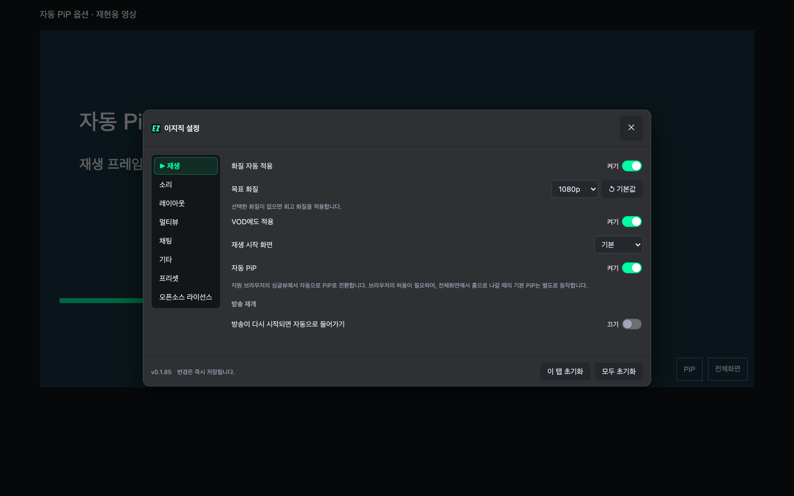
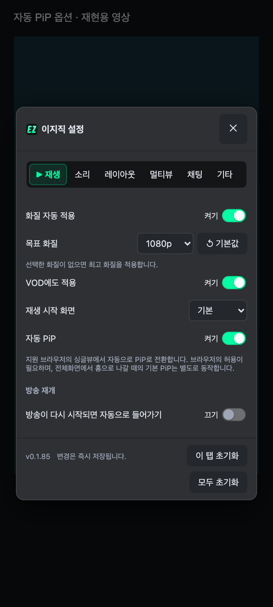
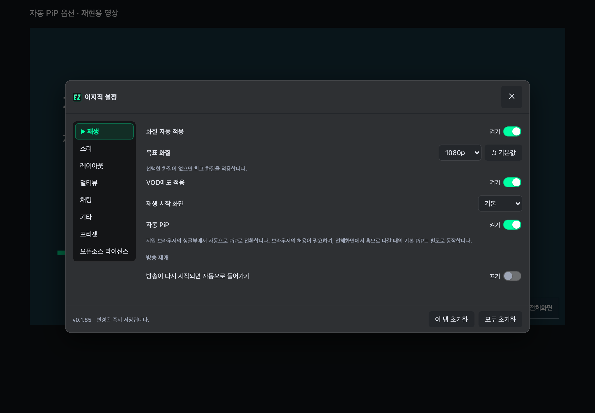
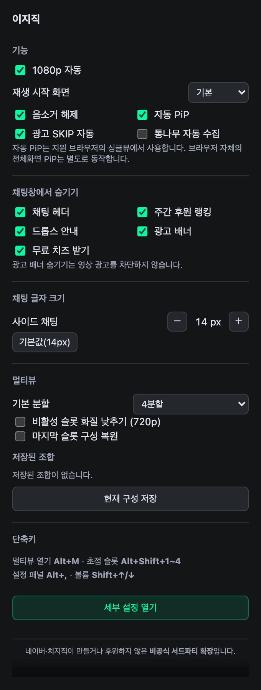

# 자동 PiP 옵션

2026-11-10. **이지직 설정 → 재생 → 자동 PiP** 또는 확장 팝업에서 켜고 끈다. 기본값은 끄기다. 변경은 즉시 저장되며 재생 탭 초기화·옵션 프리셋에도 포함된다.

켜면 지원 브라우저의 자동 PiP 액션에 응답해 현재 재생 중인 싱글뷰 영상을 PiP로 전환한다. 광고·멀티뷰·일시정지·종료·숨겨진 영상과 PiP가 금지된 영상은 제외한다. 이미 PiP로 보고 있는 영상은 중복 요청하지 않는다. 영상 요소가 교체되어도 요청 시점의 본방송을 다시 찾는다.

끄면 이지직의 자동 액션 등록을 해제한다. 이미 열린 PiP는 닫지 않으며 수동 PiP도 금지하지 않는다. 끈 뒤 늦게 승인된 이지직 요청만 취소한다. 브라우저 자체의 **전체화면 → 홈 PiP는 이 옵션과 별도로 동작**한다.

## 브라우저 지원 범위

이 옵션은 안드로이드 홈 이동을 직접 감지해 PiP 권한을 우회하지 않는다. 브라우저가 자동 PiP를 지원·허용하고 이지직에 자동 액션을 전달해야 한다. 액션 등록 성공만으로 홈 이동 지원까지 보장하지는 않는다.

Chromium에는 [Android 자동 PiP 실험 구현](https://chromium.googlesource.com/chromium/src/+/main/media/base/media_switches.cc)이 있지만, 제품·버전·실험 활성화·권한에 따라 동작이 다르다. 이 옵션을 켜도 모든 Android/Edge 환경에서 일반 화면 → 홈 자동 PiP가 보장되는 것은 아니다.

## 검증

기존 전체화면 복귀 브라우저 회귀 4개 경로도 통과했다. Node 24.22.2에서 테스트 1,430개 통과·4개 건너뜀. 빌드·린트·포맷 검사를 통과했다. React UI는 기존 토글·설정 저장 흐름을 사용하며 접근성 이름과 현재 켜기·끄기 상태를 유지한다.

Chromium에 빌드한 확장을 로드하고 재현용 캔버스 영상에서 아래 경로를 확인했다.

- 설정 ON 저장 → 자동 액션 등록 → 팝업에도 ON 반영
- 등록 콜백 → 실제 영상 PiP API 진입
- PiP 중 focus/playing 이벤트 → 확장의 전체화면 추가 요청 없음
- 팝업 OFF 저장 → 자동 액션 해제 → 기존 PiP 유지
- OFF 상태에서도 직접 누르는 수동 PiP 정상 진입
- 설정 화면: 노트북 1440×900, 태블릿 1180×820, 모바일 412×915

브라우저 자동 액션 전달은 확장 실행 문맥의 등록 콜백을 CDP에서 `userGesture: true`로 호출해 재현했다. Android HOME 제스처나 실제 브라우저 자동 승인 정책이 검증된 것으로 해석하지 않는다. **실제 PiP API 전환과 설정 흐름을 검증한 것이며, 실물 폴드·Edge Android의 홈 자동 PiP 성공을 확인한 것은 아니다.**

[브라우저 기록](auto-pip-report.json) · 재현 스크립트: `scripts/verify-auto-pip.mjs`.

```sh
yarn test
yarn build
yarn lint
yarn format:check
node scripts/verify-auto-pip.mjs
```








