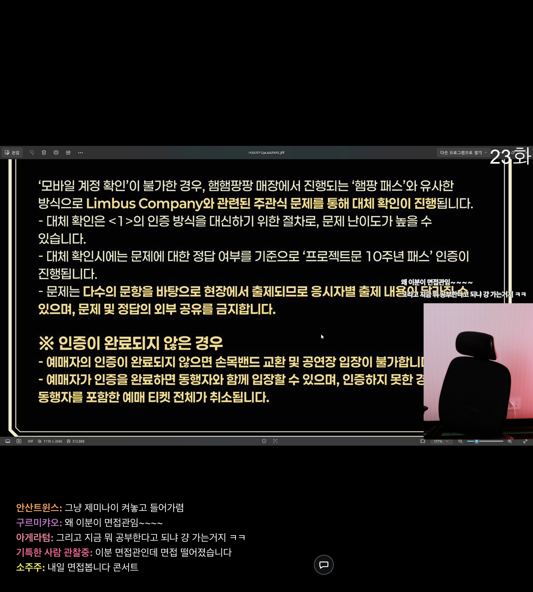
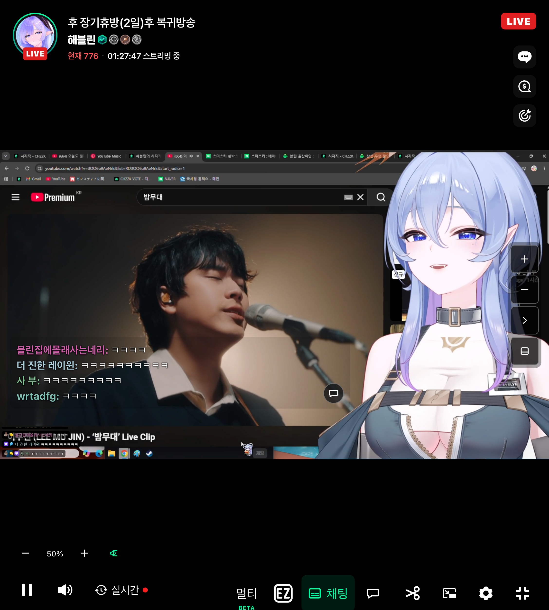
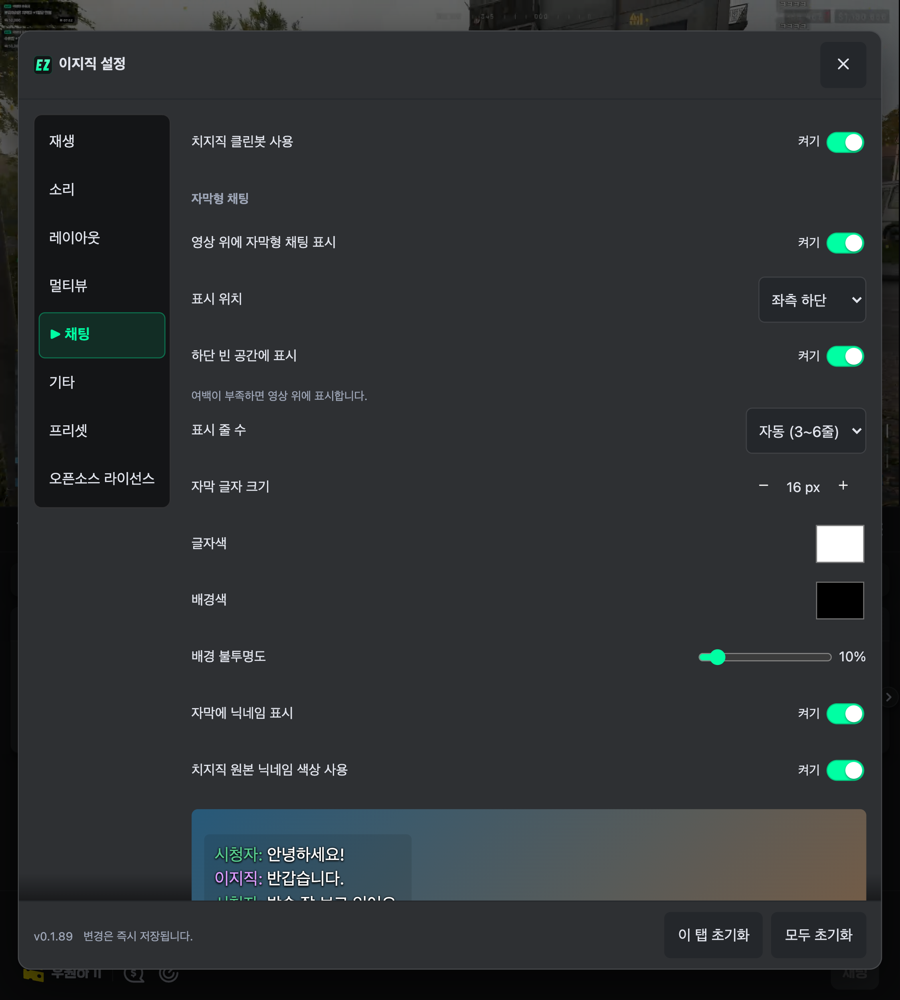

# 하단 빈 공간에 채팅 표시

**설정 → 채팅 → 자막형 채팅 → 하단 빈 공간에 표시**에서 켜고 끈다. 기본값은 꺼짐이다.

켜면 영상 아래 검은 여백에 채팅을 표시한다. 선택한 좌측·가운데·우측 위치와 글자 크기를 유지하며, 공간에 맞춰 3~6줄을 보여준다. 볼륨·재생 조작부를 피하고, 3줄이 들어갈 공간이 없으면 영상 위의 기존 위치로 돌아온다. 오른쪽 아래 말풍선으로 채팅 입력창도 열 수 있다.

화면 회전·접기·펼치기·전체화면 전환과 영상 비율 변경에 맞춰 배치를 다시 계산한다. 설정은 새로고침 후에도 유지하며 자막 설정 초기화와 프리셋에도 포함된다.

## 실제 방송 캡처

2026-11-14 Chromium 151.0.7922.34에서 확장을 로드해 실제 치지직 방송과 채팅을 촬영했다. 859×954 터치 뷰포트 참조 에뮬레이션이며, 안드로이드 실기기 검증은 아니다. 광고가 끝나고 재생 시간이 진행되는 상태를 확인한 뒤 저장했다. 아래 ON/OFF 화면은 서로 다른 방송이다.

| 켜짐 — 영상 아래 여백 | 꺼짐 — 영상 위 |
| --- | --- |
|  |  |

새 옵션을 포함한 기존 폴드 설정 스크린샷도 교체했다.



## 검증

- 실제 방송에서 859×954 → 915×412 → 859×954로 변경하며 여백 배치 → 영상 위 → 여백 배치 전환을 확인했다. 같은 video와 말풍선 버튼을 유지하고 재생이 계속됐다.
- 컨트롤이 표시된 상태에서는 영상 끝 y=718.6 아래에 채팅(y=747~835)을 배치하고, 조작부(y=843)와 8px 간격을 확보했다. 컨트롤이 사라지면 여유 공간만큼 줄 수가 늘어난다. [켜짐 측정](chat-subtitle-bottom-space-report.json) · [꺼짐 측정](chat-subtitle-bottom-space-off-report.json)
- 단위·통합 테스트로 기본 꺼짐, 기존 저장값 병합, ON/OFF 변경, 초기화, 세 위치, 최소 3줄, 부족한 여백, 볼륨 줄 회피와 영상 비율 변경을 확인했다.
- 전체 테스트 1,473개 통과, 4개 건너뜀. 빌드·타입 검사·린트·포맷 검사 통과.

```sh
yarn demo:shots chat-subtitle-bottom-space-off,chat-subtitle-bottom-space,chat-subtitle-bottom-space-settings fold8-ultra-open
```
