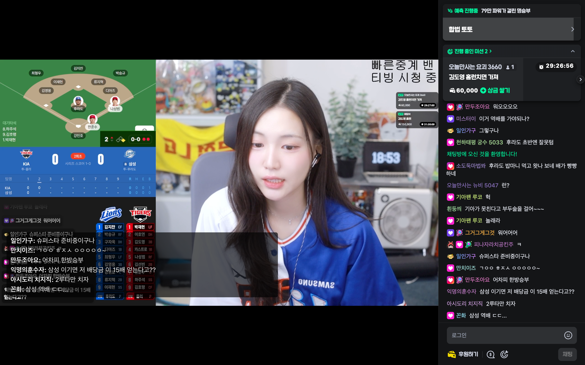
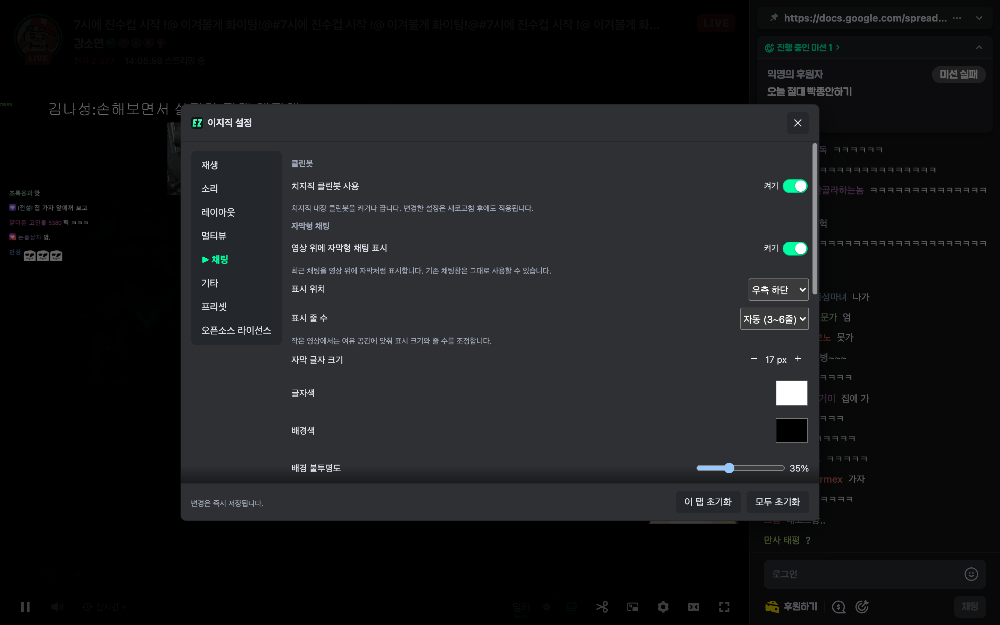
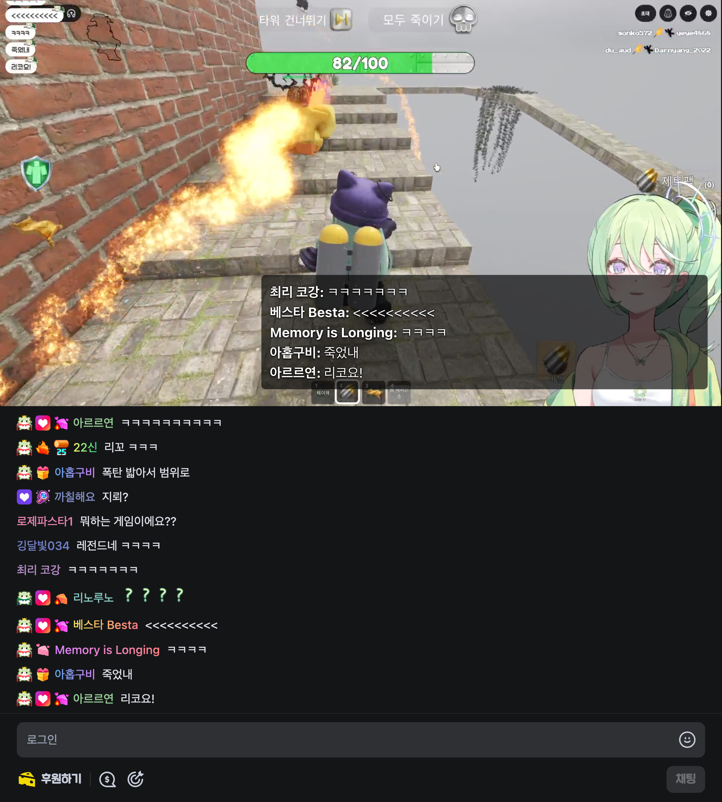
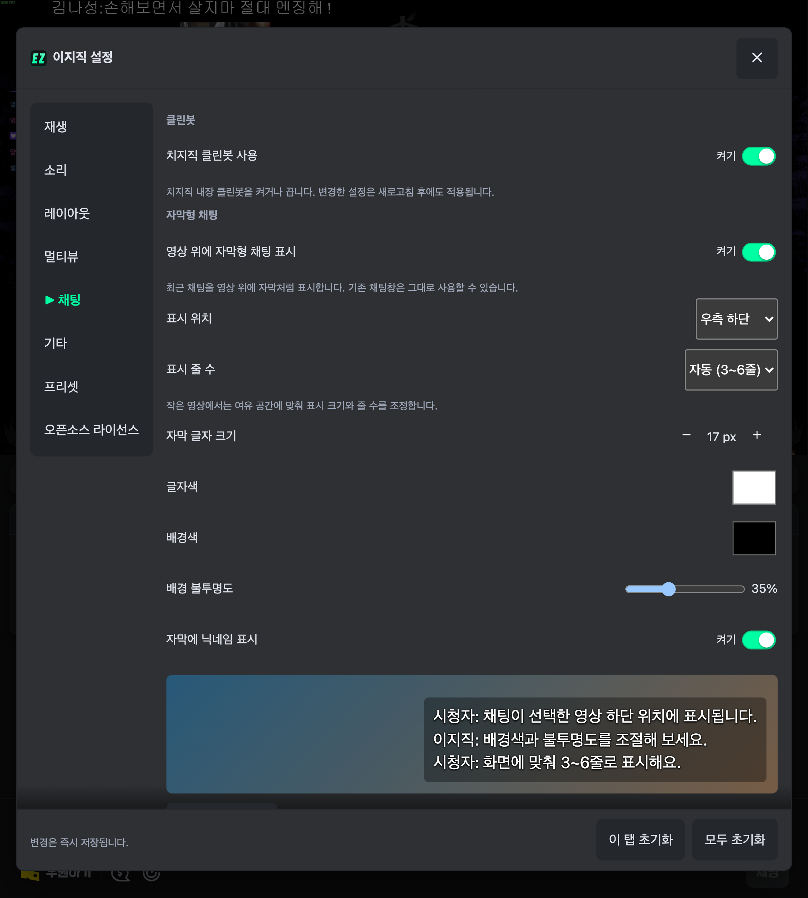
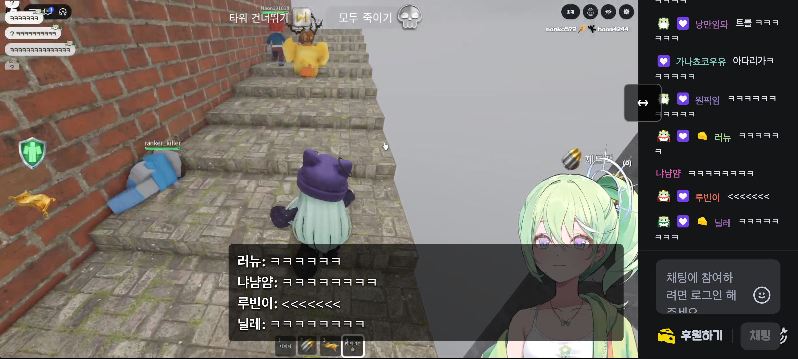
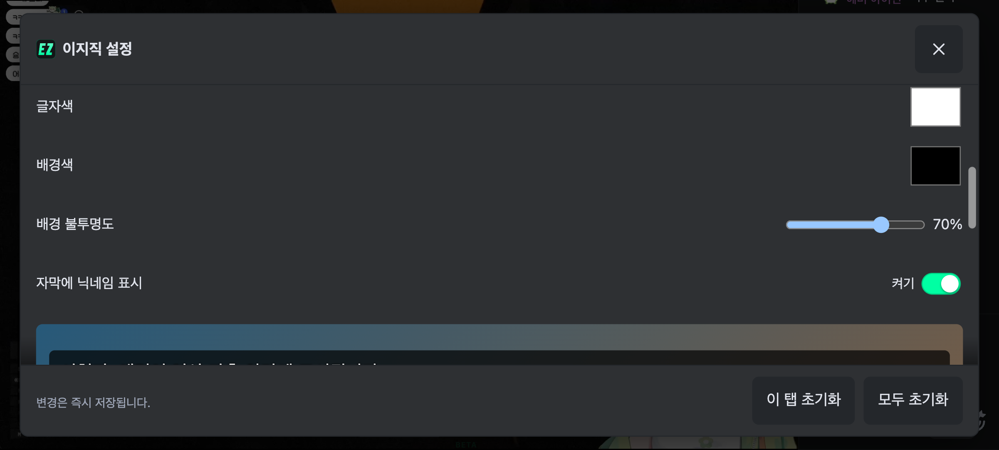
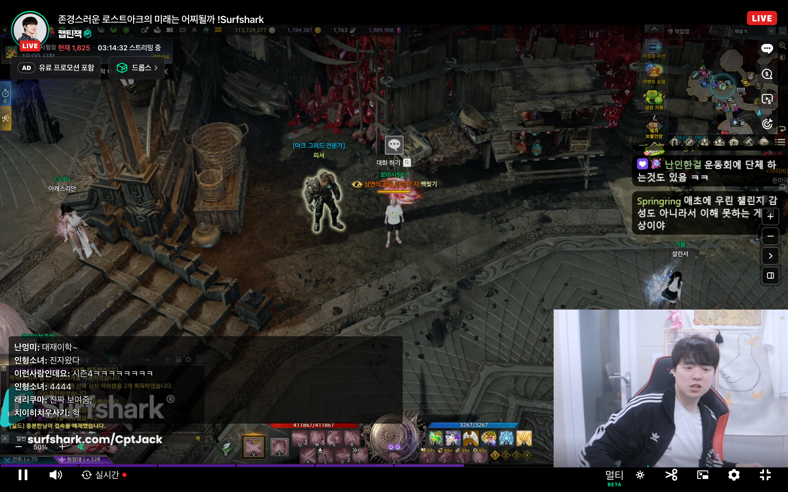
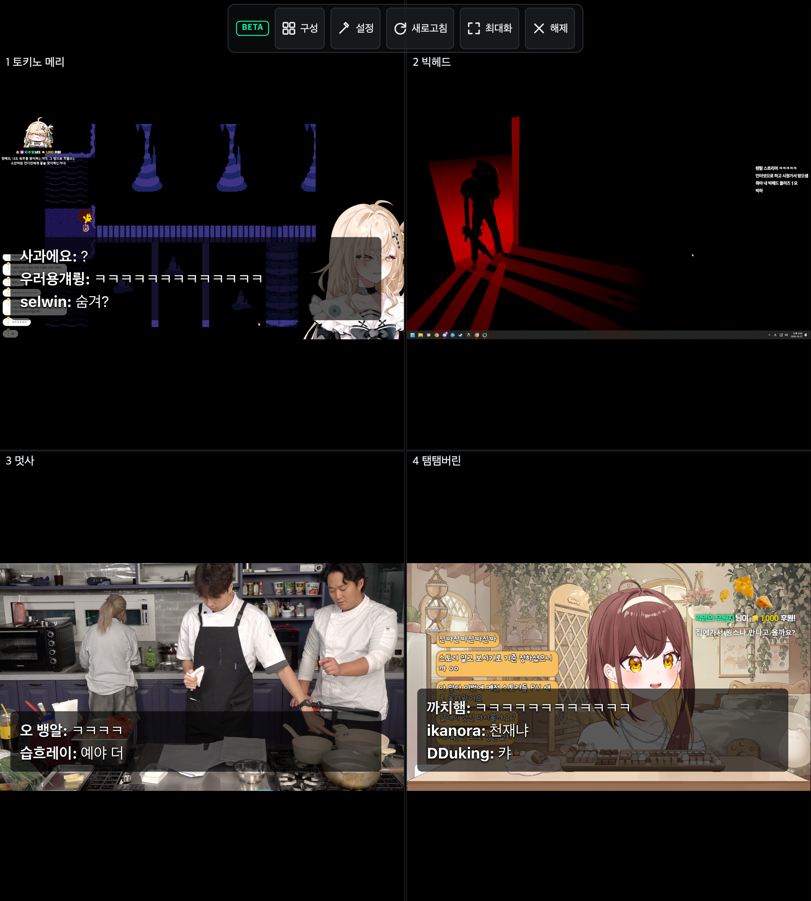
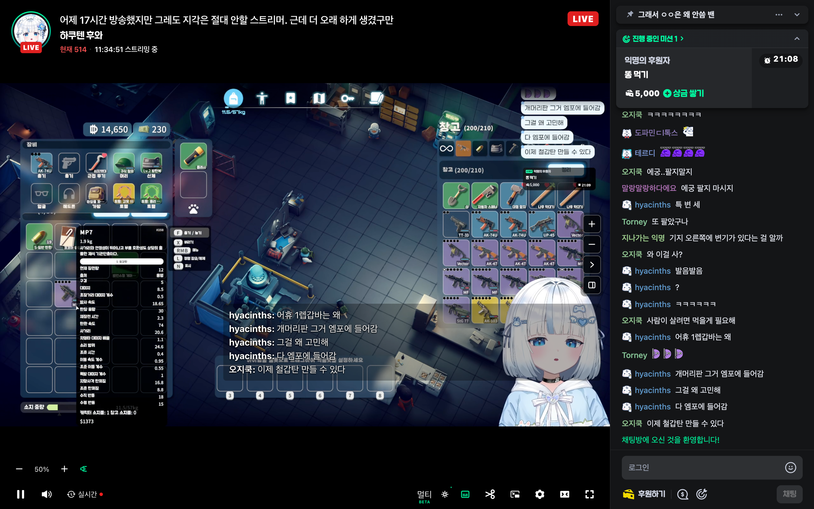
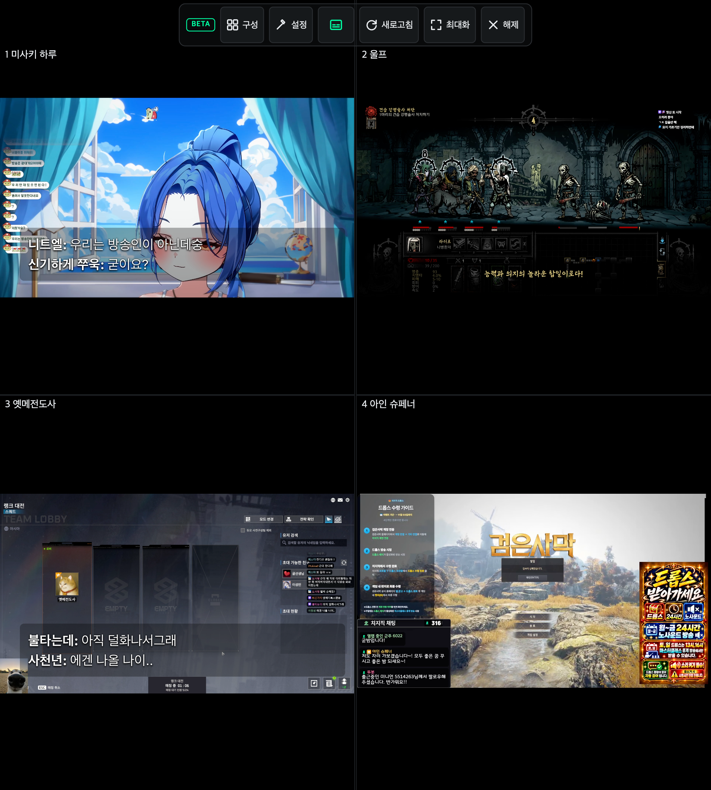

# 자막형 채팅

설정 → **채팅** → **영상 위에 자막형 채팅 표시**에서 켠다. 영상 컨트롤바의 자막 아이콘으로도 켜고 끌 수 있다. 켜짐은 초록색으로 표시하고, 멀티뷰 상단의 같은 아이콘은 모든 슬롯에 적용한다. 설정창과 같은 값을 저장하며 위치·색·줄 수는 유지한다. 기본값은 끄기이며 기존 채팅창과 입력창을 유지한다. 일반 라이브·전체화면·멀티뷰의 각 슬롯에서 사용할 수 있다.

[유튜브 자막 설정](https://support.google.com/youtube/answer/100078?hl=ko)의 배경색·불투명도·글자색·크기 구성을 참고했다.

- **표시 위치:** 좌측 하단·가운데 하단·우측 하단 중 선택. 기본값은 우측 하단.
- **표시 줄 수:** 자동(영상 공간에 따라 3~6줄), 또는 3·4·5·6줄 선택.
- **글자 크기:** 12~28px. 작은 영상에서는 들어갈 수 있는 크기와 줄 수로 조정한다.
- **글자색·배경색:** 색상 선택기로 조절한다.
- **배경 불투명도:** 0~100%. 기본 검정 30%와 흰 글자, 그림자로 가독성을 확보한다.
- **닉네임:** 표시 여부를 선택할 수 있다.
- 미리보기에 변경이 즉시 반영되며, 새로고침 후에도 설정을 유지한다. 채팅 탭 초기화·자막 설정 초기화·설정 프리셋에 포함된다.

자막은 최신 채팅을 아래쪽에 표시하고, 긴 문장은 줄을 바꾼다. 선택한 높이를 넘으면 오래된 줄부터 가려 최신 3~6줄을 보여준다. 검은 여백을 제외한 실제 영상의 선택한 하단 위치에 붙이고, 컨트롤바가 나타나면 위로 이동한다. 영상 클릭·더블클릭·터치 조작을 가로막지 않는다.

표시할 채팅이 없으면 자막을 숨긴다. 메시지를 별도로 저장하거나 전송하지 않는다.

2026-10-28부터 기본 배경 불투명도는 30%다. 아래 기존 캡처는 변경 전 설정이며, 새 캡처의 불투명도 조정 검증은 30% → 35%로 실행한다.

## 실제 방송 검증

2026-10-27 확장을 로드한 Chromium에서 실제 치지직 방송과 채팅을 캡처했다. 모바일·폴드 프로필은 터치 입력과 데스크톱 사이트 모드를 에뮬레이션한 참조 뷰포트다.

- 채팅 표시 순서와 최신 메시지 반영, 3~6줄 범위, 영상 내부 배치 확인.
- 실제 설정 UI로 좌측·가운데·우측 하단 전환 및 우측 하단 저장 확인.
- 실제 설정 UI로 글자 크기 17px·불투명도 70% 변경 → 끄기·켜기 → 새로고침 후 유지 확인.
- 아이콘으로 끄기·켜기 시 표시 상태와 저장값 동기화, 재생 클릭 전파 차단, 컨트롤바 재생성 후 복원 확인.
- 전체화면에서도 자막이 fullscreen 요소 내부에 표시되는지 확인.
- 멀티뷰에서도 원본 채팅이 있는 슬롯의 자막 표시 확인.
- 타입 검사·빌드·린트·포맷 검사 통과. 테스트 1,280개 통과, 4개 건너뜀.

| 화면 | 자막형 채팅 | 설정 |
| --- | --- | --- |
| 노트북 1440×900 |  |  |
| 폴드 울트라 펼침 859×954 |  |  |
| 모바일 가로 915×412 |  |  |

| 전체화면 | 멀티뷰 |
| --- | --- |
|  |  |

재현 명령은 동시에 실행하지 않는다(브라우저 프로필 경로를 공유한다).

```sh
yarn demo:shots chat-subtitle,chat-subtitle-settings laptop13,fold8-ultra-open,mobile-landscape
yarn demo:shots chat-subtitle-fullscreen laptop13
yarn demo:shots chat-subtitle-multiview fold8-ultra-open
```

## 빠른 켜기·끄기

| 영상 컨트롤바 | 멀티뷰 상단 바 |
| --- | --- |
|  |  |

```sh
yarn demo:shots chat-subtitle-toggle laptop13,fold8-ultra-open
yarn demo:shots chat-subtitle-multiview-toggle fold8-ultra-open
```
