# 자막형 채팅

설정 → **채팅** → **영상 위에 자막형 채팅 표시**에서 켠다. 영상 컨트롤바의 자막 아이콘으로도 켜고 끌 수 있다. 켜짐은 초록색으로 표시하고, 멀티뷰 상단의 같은 아이콘은 모든 슬롯에 적용한다. 설정창과 같은 값을 저장하며 위치·색·줄 수는 유지한다. 기본값은 끄기이며 기존 채팅창과 입력창을 유지한다. 일반 라이브·전체화면·멀티뷰의 각 슬롯에서 사용할 수 있다.

**오버레이 오른쪽 아래 말풍선**을 누르면 작은 입력창이 열린다. 전체화면과 멀티뷰에서도 해당 방송에 채팅을 보낼 수 있다. [화면 보기](overlay-chat-compose.md)

[유튜브 자막 설정](https://support.google.com/youtube/answer/100078?hl=ko)의 배경색·불투명도·글자색·크기 구성을 참고했다.

- **표시 위치:** 좌측 하단·가운데 하단·우측 하단 중 선택. 기본값은 좌측 하단.
- **하단 빈 공간에 표시:** 기본 꺼짐. 켜면 영상 아래 검은 여백을 사용한다. 최소 3줄과 입력 버튼이 들어갈 공간이 없으면 영상 위에 표시한다. [ON/OFF 비교와 설정 화면](chat-subtitle-bottom-space.md)
- **표시 줄 수:** 자동(영상 공간에 따라 3~6줄), 또는 3·4·5·6줄 선택.
- **글자 크기:** 12~28px. 작은 영상에서는 들어갈 수 있는 크기와 줄 수로 조정한다.
- **글자색·배경색:** 색상 선택기로 조절한다.
- **배경 불투명도:** 0~100%. 기본 검정 10%와 흰 글자, 그림자로 가독성을 확보한다.
- **닉네임:** 표시 여부를 선택할 수 있다. 기본으로 치지직 원본 채팅의 닉네임별 색상을 사용하며, **치지직 원본 닉네임 색상 사용**을 끄면 선택한 글자색으로 통일한다.
- **이모티콘:** 스트리머 구독 이모티콘과 공통 이모티콘을 본문 순서대로 표시한다. GIF도 원본 이미지 주소를 유지하며, 이미지를 불러오지 못하면 이모티콘 이름을 표시한다.
- 미리보기에 변경이 즉시 반영되며, 새로고침 후에도 설정을 유지한다. 채팅 탭 초기화·자막 설정 초기화·설정 프리셋에 포함된다.

자막은 최신 채팅을 아래쪽에 표시하고, 긴 문장은 줄을 바꾼다. 선택한 높이를 넘으면 오래된 줄부터 가려 최신 3~6줄을 보여준다. 기본으로 실제 영상의 선택한 하단 위치에 붙이고, ‘하단 빈 공간에 표시’를 켜면 충분한 여백이 있을 때 그곳으로 이동한다. 컨트롤바가 나타나면 위로 이동한다. 말풍선 버튼을 제외한 영역은 영상 클릭·더블클릭·터치 조작을 가로막지 않는다.

표시할 채팅이 없어도 입력용 말풍선은 남는다. 사용자가 작성해 전송한 내용은 원본 치지직 입력창과 채팅 버튼으로 처리한다.

기본 위치는 좌측 하단이며 저장된 위치는 유지한다. 폴드 일반·설정 캡처는 새 기본 위치로 갱신했고, 나머지 캡처는 선택 가능한 우측 하단 배치를 보여준다.

아래 기존 시청 화면은 이전 기본 배경 불투명도 30%로 촬영했다. 현재 기본값은 10%이며 사용자가 저장한 값은 유지한다. 노트북·모바일 설정 화면은 변경·저장 검증을 위해 35%로 조절했다. 폴드 설정 화면은 2026-11-14 새 여백 옵션과 기본 불투명도 10%로 교체했다.

## 실제 방송 검증

2026-10-28 확장을 로드한 Chromium에서 실제 치지직 방송과 채팅을 캡처했다. 모바일·폴드 프로필은 터치 입력과 데스크톱 사이트 모드를 에뮬레이션한 참조 뷰포트다.

- 채팅 표시 순서와 최신 메시지 반영, 3~6줄 범위, 영상 내부 배치 확인.
- 실제 설정 UI로 좌측·가운데·우측 하단 전환 및 좌측 하단 저장 확인.
- 실제 설정 UI로 글자 크기 17px·불투명도 35% 변경 → 끄기·켜기 → 새로고침 후 유지 확인.
- 아이콘으로 끄기·켜기 시 표시 상태와 저장값 동기화, 재생 클릭 전파 차단, 컨트롤바 재생성 후 복원 확인.
- 전체화면에서도 자막이 fullscreen 요소 내부에 표시되는지 확인.
- 멀티뷰에서도 원본 채팅이 있는 슬롯의 자막 표시 확인.
- 타입 검사·빌드·린트·포맷 검사 통과. 테스트 1,287개 통과, 4개 건너뜀.

| 화면 | 자막형 채팅 | 설정 |
| --- | --- | --- |
| 노트북 1440×900 | 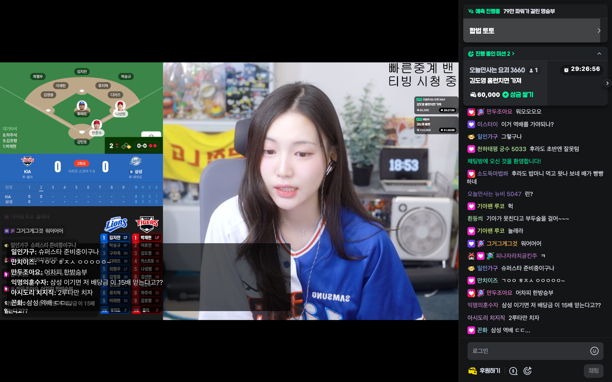 | 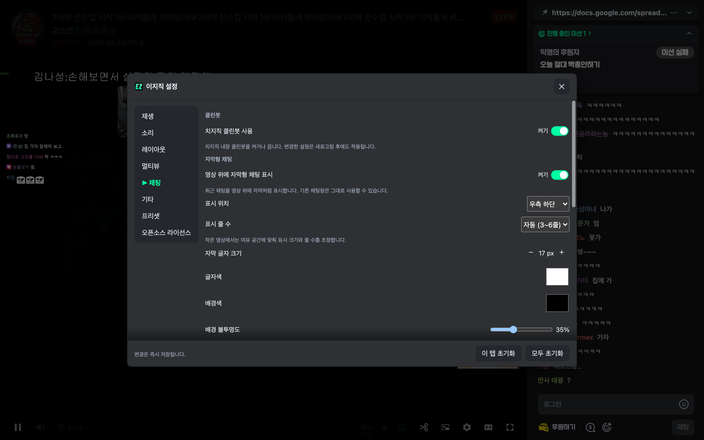 |
| 폴드 울트라 펼침 859×954 | 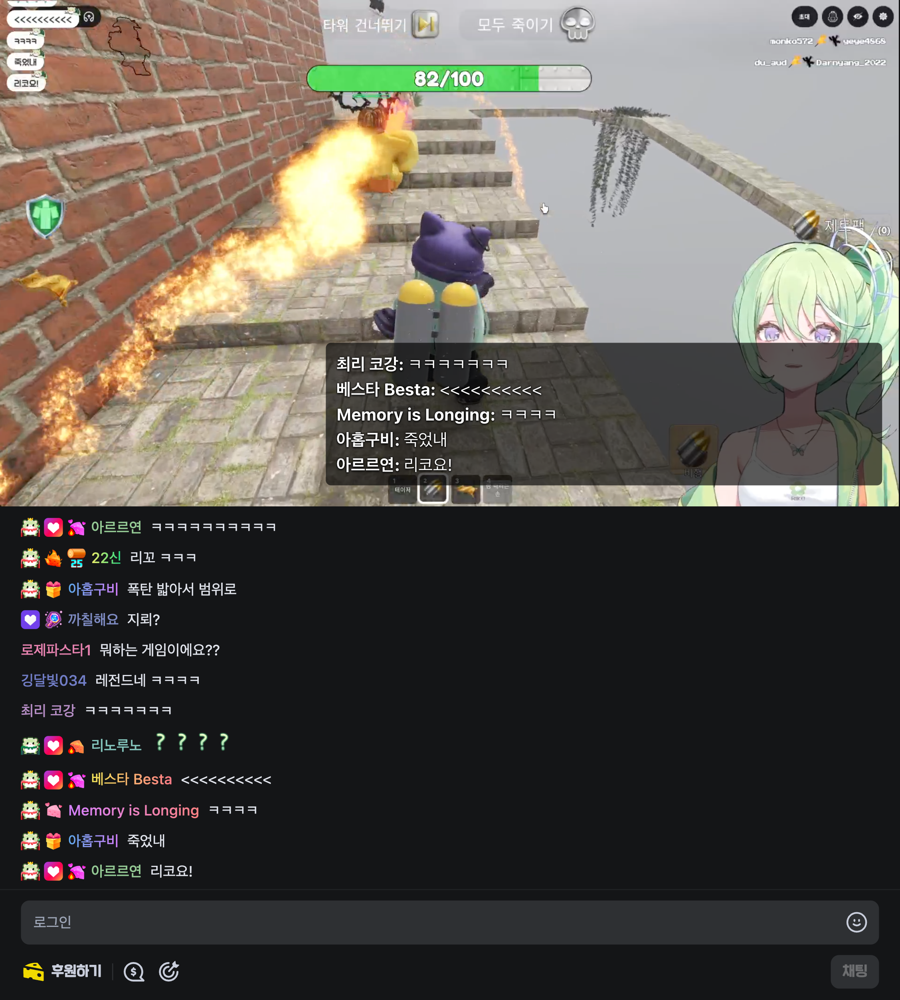 | 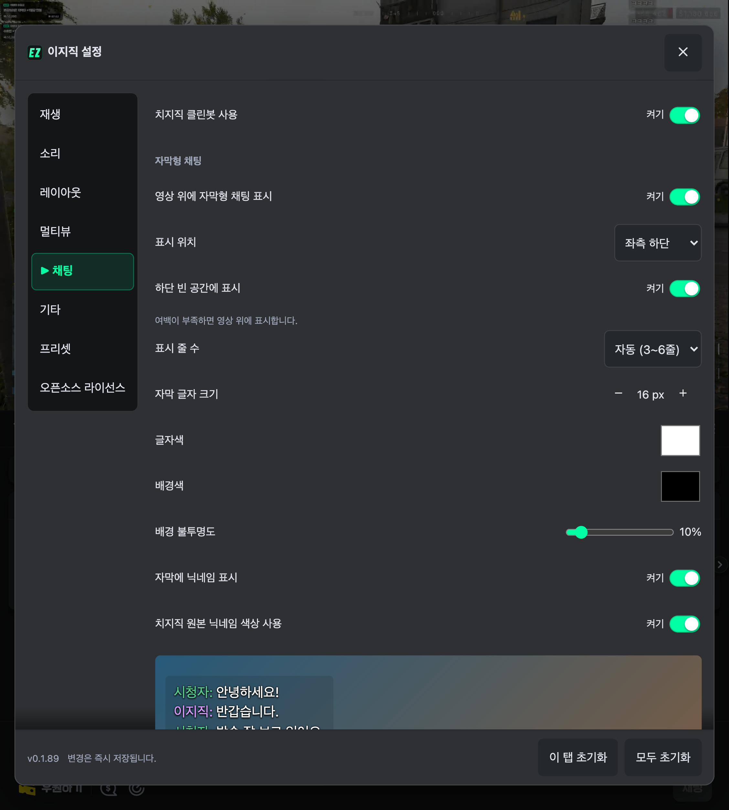 |
| 모바일 가로 915×412 | 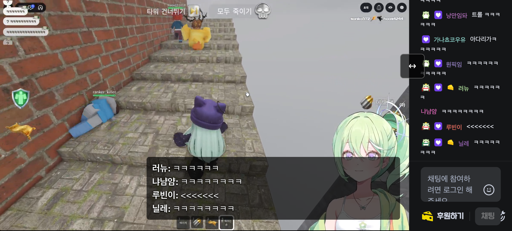 | 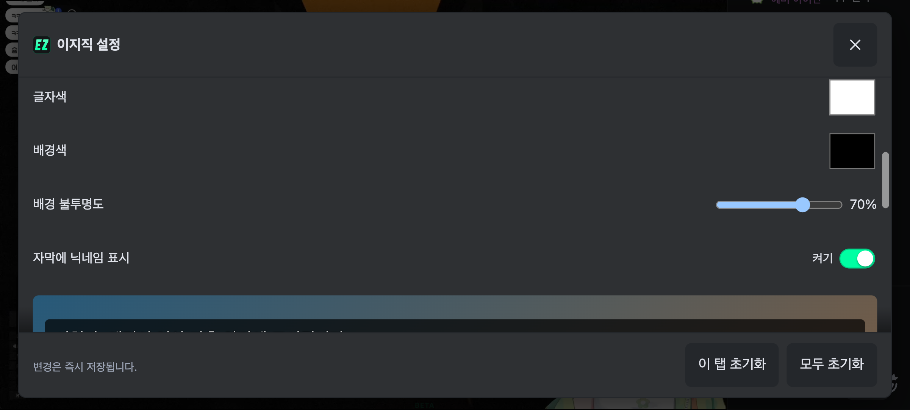 |

| 전체화면 | 멀티뷰 |
| --- | --- |
| 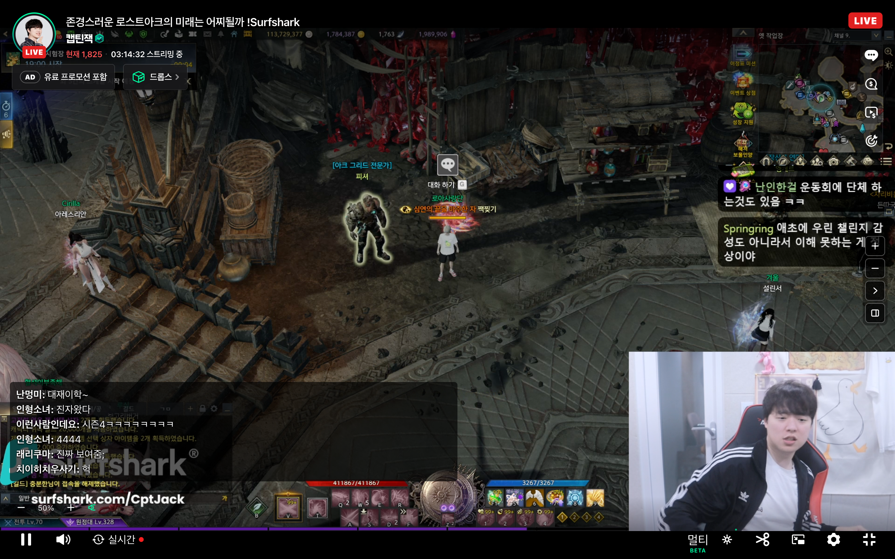 | 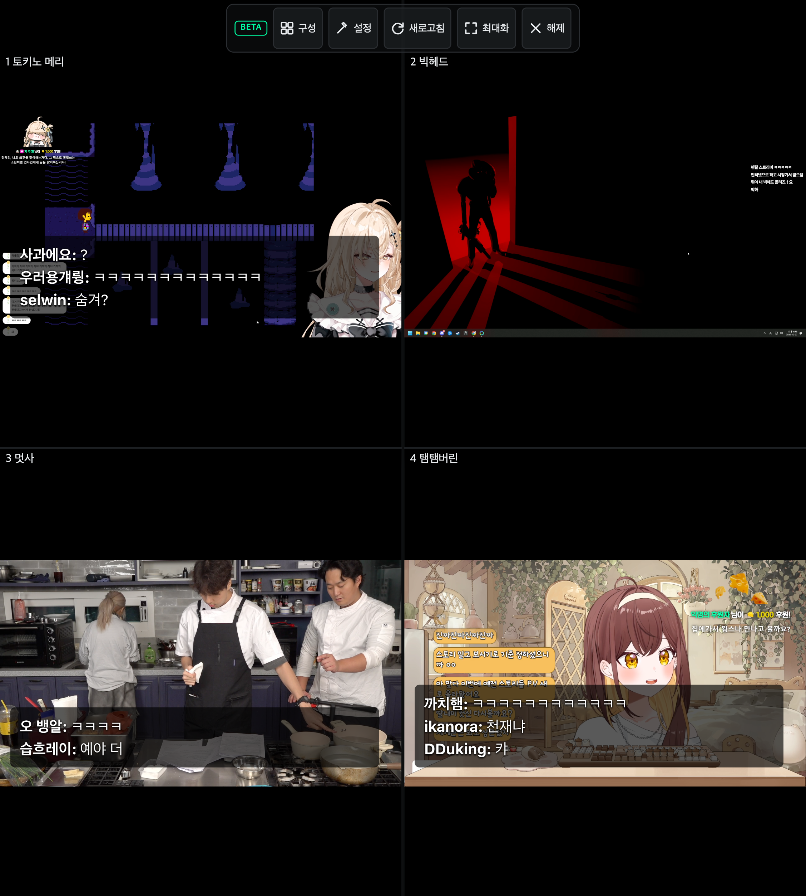 |

재현 명령은 동시에 실행하지 않는다(브라우저 프로필 경로를 공유한다).

```sh
yarn demo:shots chat-subtitle,chat-subtitle-settings laptop13,fold8-ultra-open,mobile-landscape
yarn demo:shots chat-subtitle-fullscreen laptop13
yarn demo:shots chat-subtitle-multiview fold8-ultra-open
```

## 빠른 켜기·끄기

| 영상 컨트롤바 | 멀티뷰 상단 바 |
| --- | --- |
| 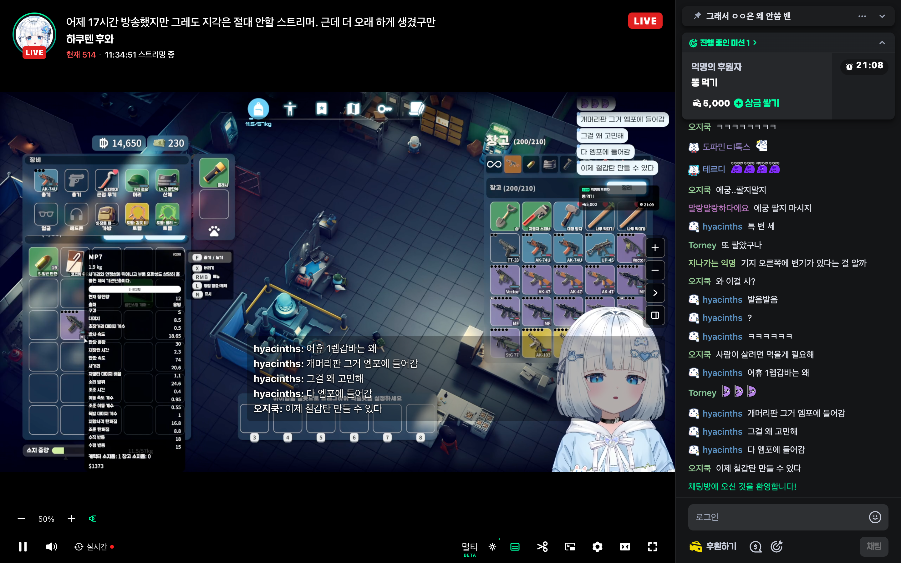 | 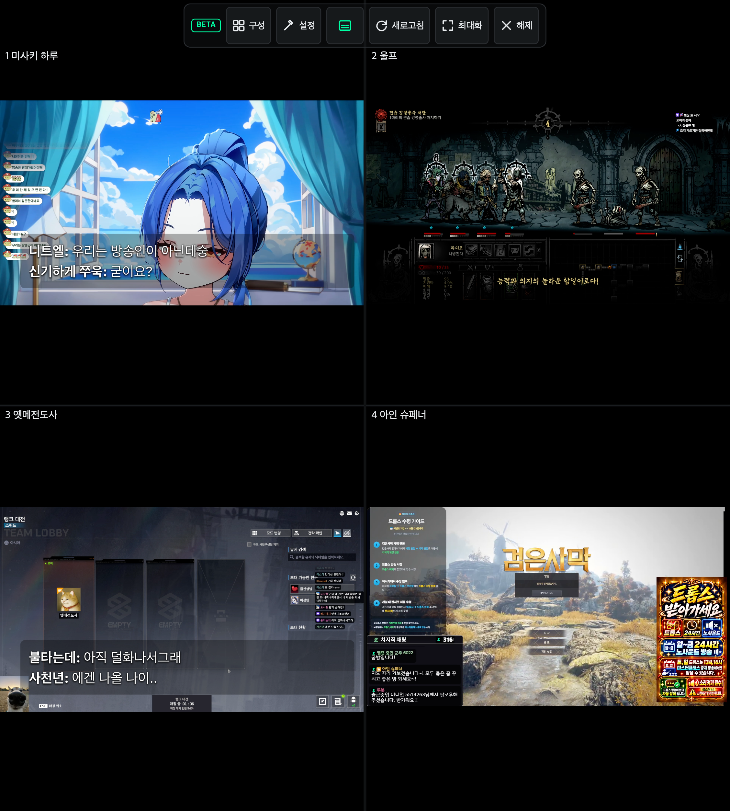 |

```sh
yarn demo:shots chat-subtitle-toggle laptop13,fold8-ultra-open
yarn demo:shots chat-subtitle-multiview-toggle fold8-ultra-open
```


## 이모티콘·닉네임 색상 검증

2026-11-01 실제 방송에서 스트리머 PNG 이모티콘이 원본 채팅과 같은 주소로 로드되고, 닉네임 6개의 색상이 원본과 일치하는 것을 확인했다. 설정에서 원본 색상 사용을 끄고 다시 켜는 동안 같은 영상 요소와 재생 상태를 유지했다. 아래 캡처는 기본 배경 불투명도 10%를 사용한다. GIF 원본 주소 보존과 이미지 실패 대체 표시는 단위 테스트로 검증했다.

| 실제 방송 오버레이 | 닉네임 색상 설정 |
| --- | --- |
| 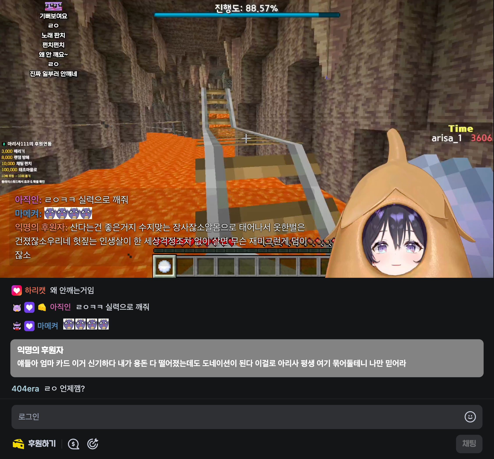 | 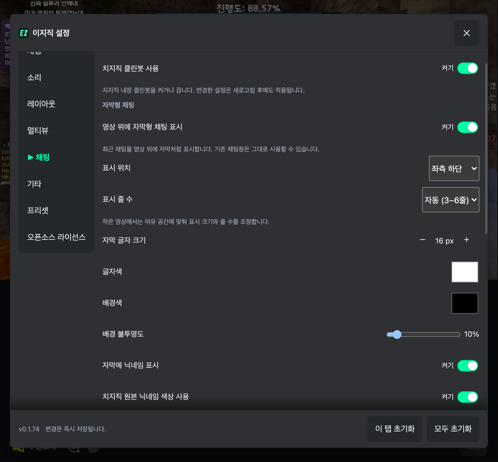 |

전체 테스트 1,347개 통과, 4개 건너뜀. 타입 검사·빌드·린트·포맷 검사 통과.

```sh
node scripts/verify-subtitle-emoticons.mjs
```

## 특정 채팅 잔류 수정 (2026-11-03)

원본 클라이언트의 `messageList`는 수신 순서이며 메시지의 `time`은 이 순서와 다를 수 있다. 실제 방송 두 곳에서도 시각 역전을 확인했다. 시각으로 다시 정렬하면 앞선 시각을 가진 과거 메시지가 마지막 여섯 개에 계속 남는다. 원본 목록 순서를 유지하고 뒤의 여섯 개만 읽도록 수정했다.

모의 채팅을 사용하는 Chromium 검사에서 수정 전 새 메시지 8개 뒤에도 과거 메시지가 하단에 남는 현상을 재현했다. 수정 후 일반·슬롯 모드에서 12개 메시지를 연속 입력해 오래된 메시지 제거, 시각 없는 최신 메시지 표시, 하단 스크롤 유지를 검사한다. 실제 방송에 테스트 채팅을 전송하지 않는다.

```sh
yarn build
node scripts/verify-subtitle-order.mjs
```

## 일시정지·중단 후 복구 (2026-11-05)

재생 재개(`play`·`playing`·`loadedmetadata`·`canplay`)를 캡처 단계에서 감지해 채팅 소스를 다시 읽는다. 플레이어·채팅창 교체 시에도 이전 스냅샷을 초기화한다. 중단 중 표시 DOM이 제거되면 채팅 내용이 이전과 같더라도 표시 요소를 복구한다.

Chromium의 canvas 영상 스트림과 모의 채팅으로 수정 전 빈 오버레이 잔류를 재현했다. 수정 후 일반·슬롯 모드에서 같은 영상 일시정지→재개, 플레이어 제거→새 영상·채팅 클라이언트 생성, 새 메시지 갱신, 오버레이 중복 없음까지 검사했다. 이 검증은 실제 방송의 송출 장애를 발생시키거나 실제 채팅을 전송하지 않는다.

```sh
yarn build
node scripts/verify-subtitle-resume.mjs
```
