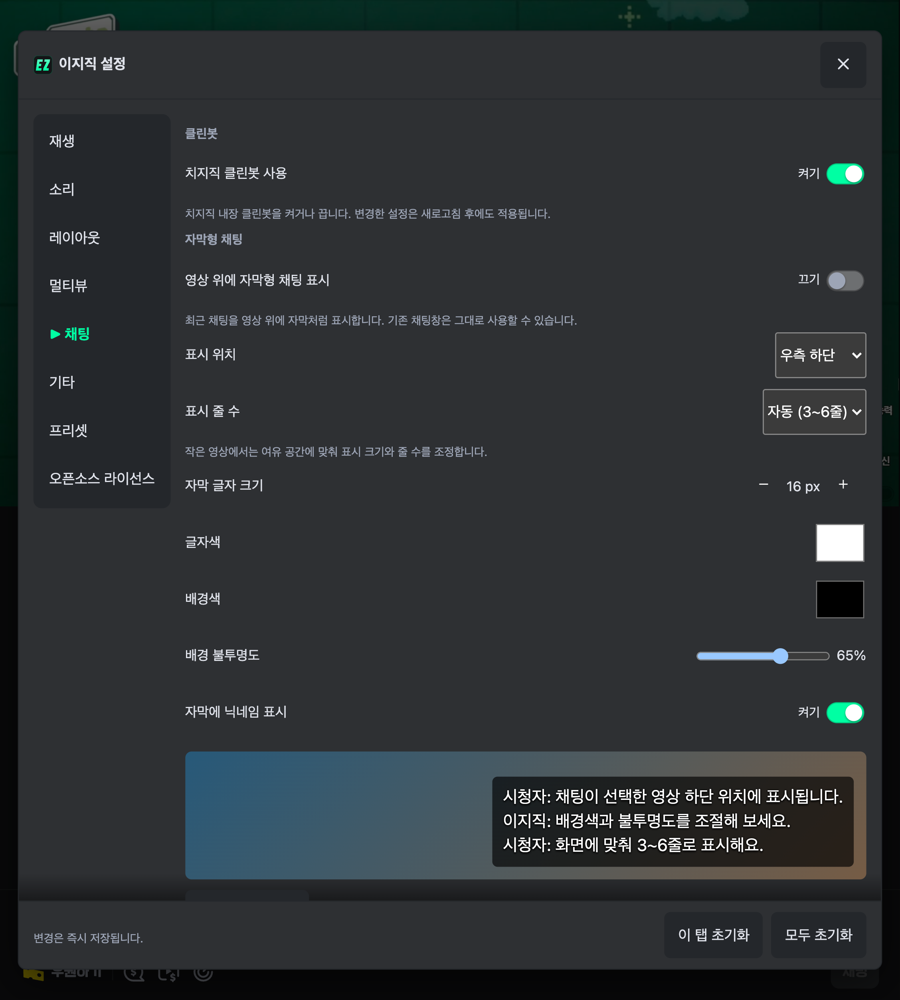

# 치지직 클린봇 켜기·끄기

이지직 설정 → **채팅** → **치지직 클린봇 사용**에서 내장 클린봇을 켜거나 끈다. 선택한 상태는 저장되며 새로고침과 채널 이동 후에도 적용된다.

처음에는 치지직에 저장된 상태를 표시하며, 직접 변경하기 전에는 원본 설정을 바꾸지 않는다. 과거 `클린봇 끄기` 설정도 이어서 적용한다. 채팅 탭 초기화는 원본 상태 유지로 돌아가며, 옵션 프리셋에도 선택값을 포함한다.

이미 선택한 상태라면 반전시키지 않는다. 빠르게 설정을 바꾸면 취소된 실행을 정리한 뒤 마지막 선택을 적용한다. 기본값으로 채팅 헤더가 숨겨져 있어도 치지직 메뉴와 확인 다이얼로그를 통해 적용한다. 별도의 욕설 필터를 만드는 기능은 아니다.

## 검증

- 테스트 1,276개 통과, 4개 건너뜀. 양방향 토글·이미 목표 상태일 때 유지·중간 취소·기존 저장값 호환 확인.
- 타입 검사·빌드·린트·포맷 검사 통과.
- 실제 방송에서 이지직 스위치로 양방향 전환 → 치지직 저장값 변경 → 새로고침 후 유지 확인.
- 아래 폴드 화면은 실기기 측정값이 아닌 859×954 터치 브라우저 참조 뷰포트다.



```sh
yarn demo:shots cleanbot-settings fold8-ultra-open
```
