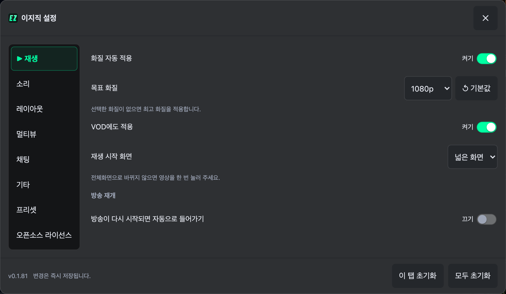
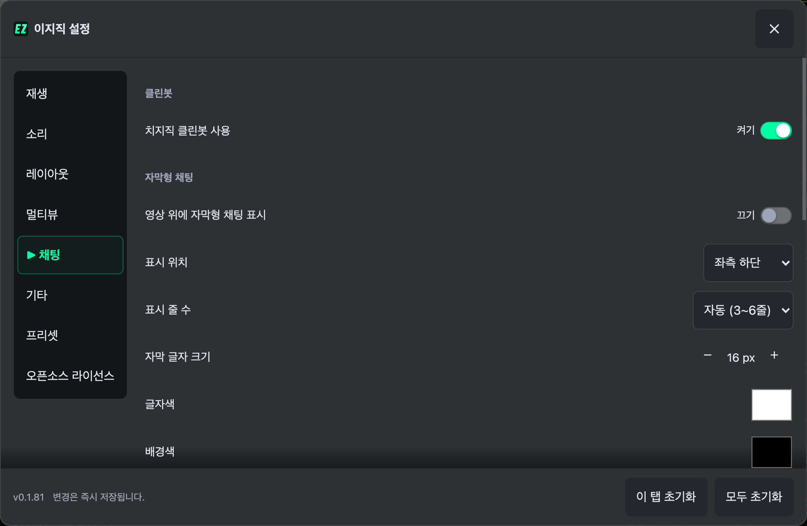
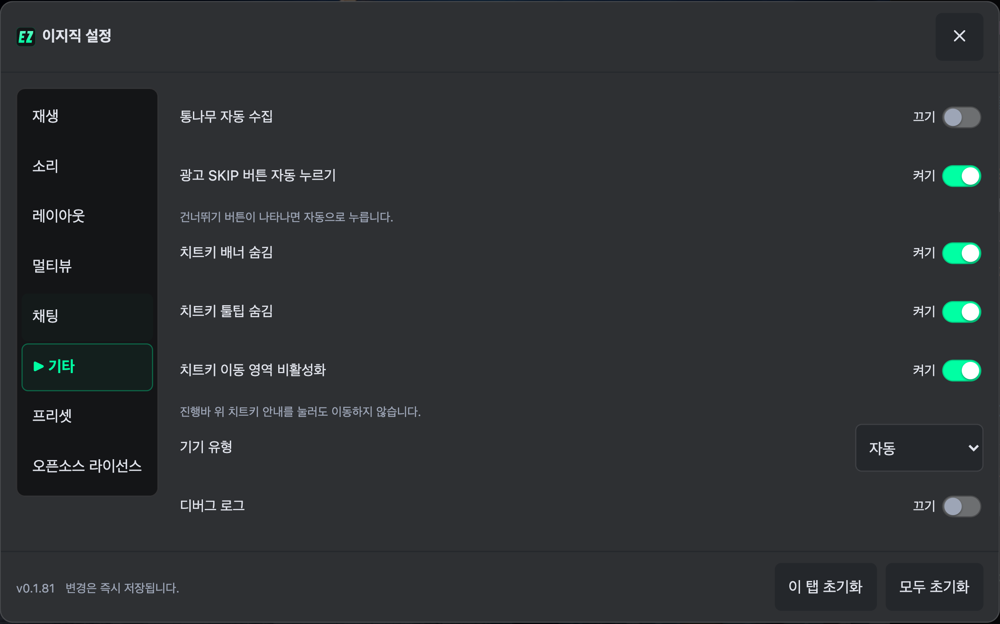
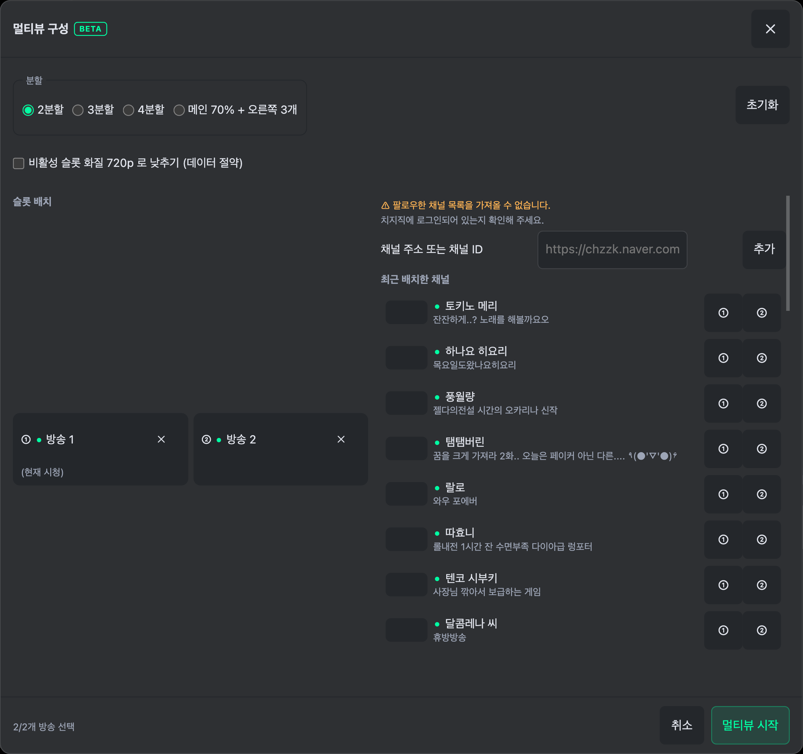
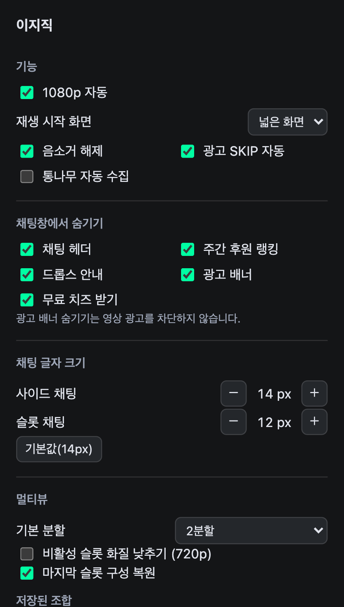

# UI 문구 정리

설정·팝업·멀티뷰 구성에서 조작과 관계없는 설명을 제거했다.

- 줄 높이·이모티콘 크기·스크롤 영역·영상 손실률 등 계산값과 내부 판정 근거 제거.
- 구현 출처는 오픈소스 라이선스 탭에 두고 소리 설정의 중복 설명 제거.
- 방송 상태 확인 주기와 ‘수정 후 제공’ 같은 구현·개발 일정 설명 제거.
- 멀티뷰 구성 하단은 `선택한 방송 수 / 분할 수`로 표시.
- 오류 안내에서 확인되지 않은 원인 추측 제거.
- 채팅 미리보기는 짧은 예시 대화로 교체하고 기기 이름은 한글로 표시.

설정 값과 동작, 초기화, 오류·빈 목록 상태, 라이선스 고지는 유지했다. 음량 증폭 시 왜곡, 전체화면 전환 방법처럼 조작에 필요한 안내는 짧게 정리했다.

## 확인 화면

## 검증

최신 main(v0.1.81) 기준 테스트 1,385개 통과·4개 건너뜀. 빌드·린트·포맷 검사 통과.

Chromium에서 실제 치지직 페이지에 확장을 로드하고 1440×900, 411×915, 915×412의 모든 설정 탭을 전환했다. 삭제 대상 문구가 표시되지 않고 대화상자가 화면 안에 있는지 확인했다. 싱글뷰·멀티뷰 설정 열기, 구성 창, 팝업도 확인했다. 실물 폴드 기기는 검증하지 않았다.
