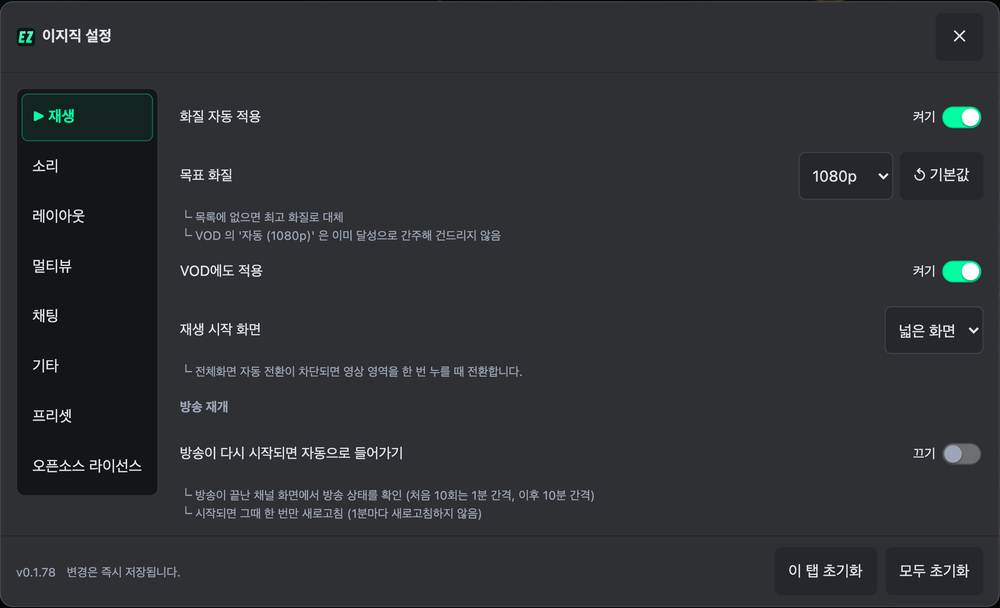
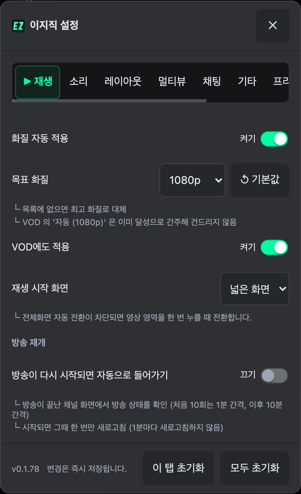
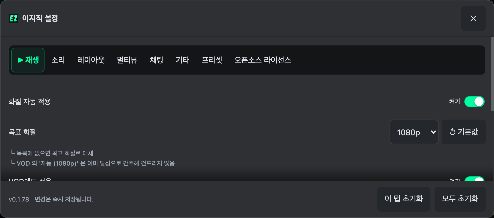
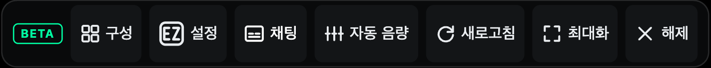
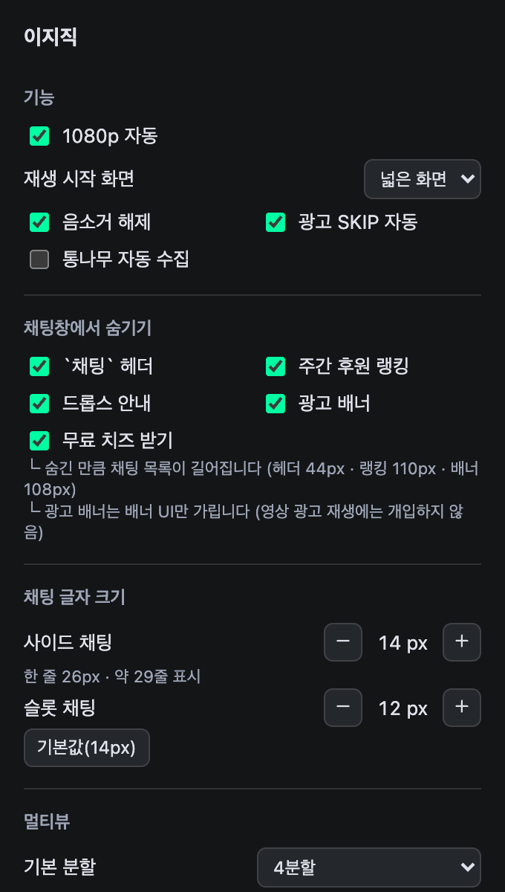

# 확장 UI 톤 정리

어두운 중립색 표면에 민트색 활성 표시를 사용한다. 설정 창·멀티뷰 바·싱글뷰 컨트롤·확장 팝업에 같은 테두리 강도와 선택·호버·키보드 포커스 규칙을 적용했다.

- 멀티뷰 바: 버튼마다 보이던 테두리를 줄이고 글자 크기와 굵기를 통일했다. 활성 토글은 민트색 텍스트와 옅은 배경·테두리로 구별한다.
- 설정 창: 탭 레일과 본문을 분리하고 선택한 탭에 민트색 배경과 테두리를 넣었다. 입력창의 배경·테두리·모서리와 섹션 간격을 정리했다.
- 싱글뷰: 활성 채팅 버튼 배경과 키보드 포커스를 표시한다.
- 팝업: 섹션 간격과 주요 버튼의 강조색을 설정 창과 맞췄다.
- 호버 효과는 마우스를 지원하는 환경에만 적용한다. 동작 줄이기 설정에서는 새 전환 효과를 끈다.

## 화면

## 검증 범위

Chromium에서 공개 생방송을 열어 싱글뷰·멀티뷰 버튼과 설정 열기를 확인했다. 설정 창은 1440×900, 411×915, 915×412에서 모든 탭을 전환하고 대화상자가 화면 안에 있는지 확인했다. 키보드 포커스 표시와 411px 멀티뷰 버튼의 44px 터치 영역도 확인했다. 실물 폴드 기기 검증은 포함하지 않는다.
