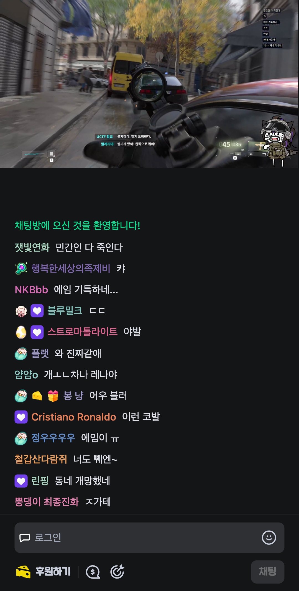
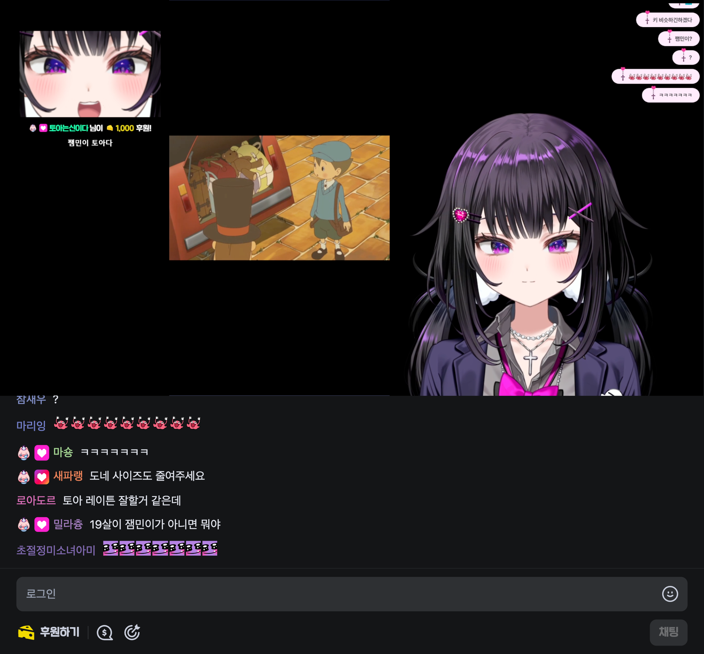
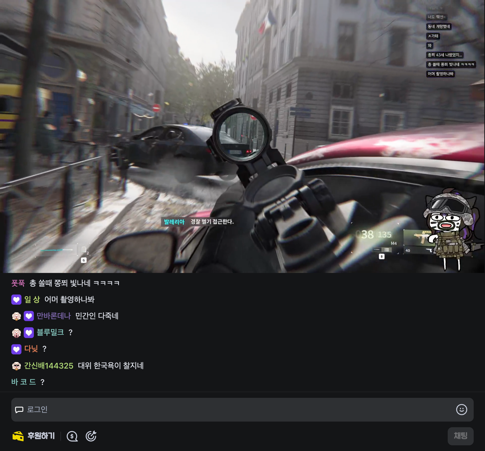
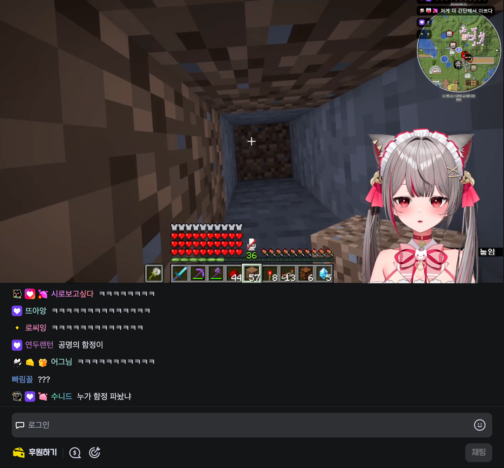
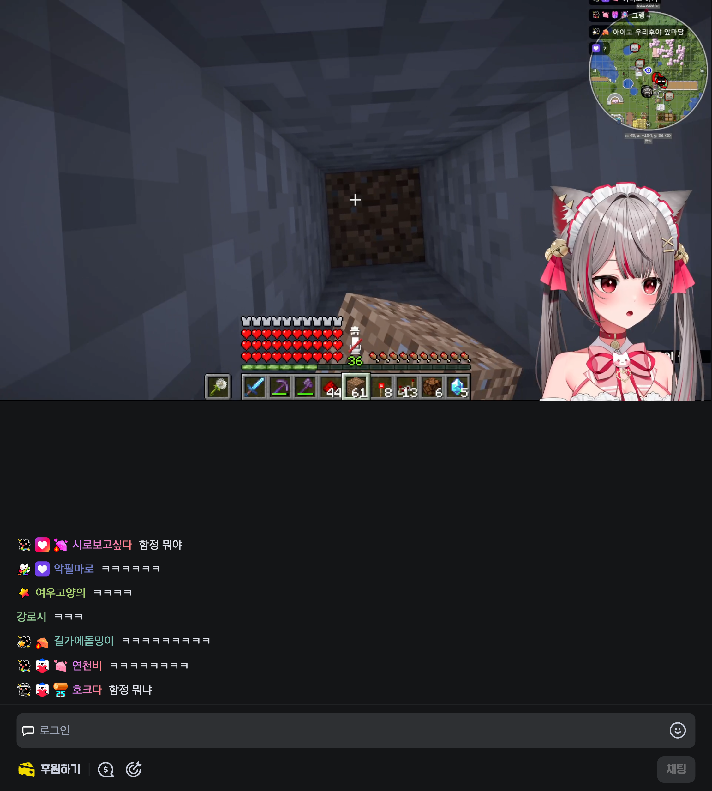
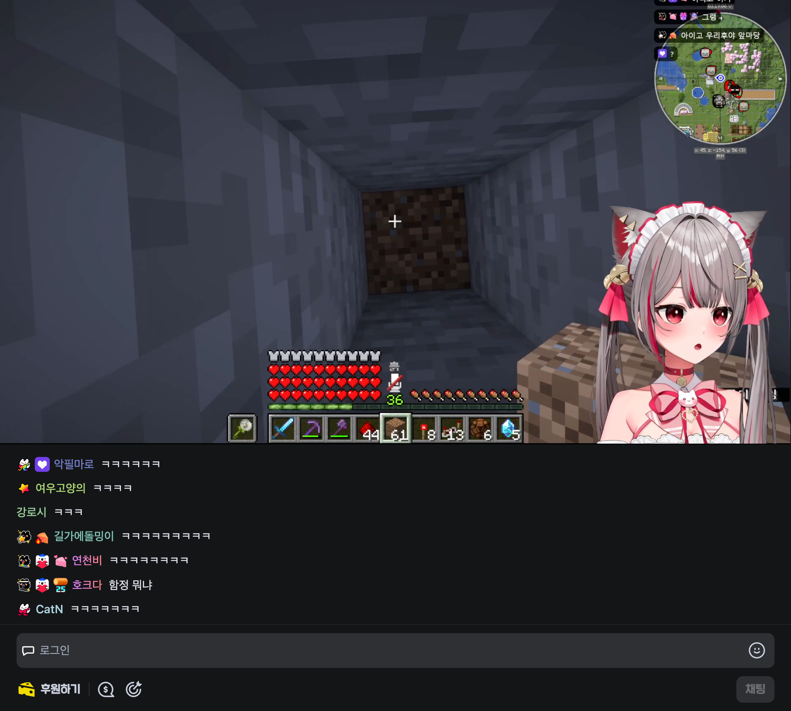

# 폴드 전환 후 채팅 아래 빈 공간 재현·수정

2026-10-28 사용자 첨부 화면처럼 접은 뒤 채팅은 몇 줄만 보이고 입력창 아래가 크게 비는 현상을 **저장된 수동 채팅 높이 20%** 조건에서 재현했다. 이전 전환 검증은 새 자동 설정만 사용해 이 조건을 놓쳤다.

치지직 `main`의 클래스가 `_container_1tswz`에서 `_container_4mxy2`로 바뀌어 기존 보정이 적용되지 않았다. 좁은 화면에서는 네이티브 `main`이 16:9 높이와 `flex: 0 0 auto`로 바뀌는데, 채팅도 고정 높이라 남는 공간을 아무도 사용하지 않았다.

- 플레이어 ID를 포함하는 `main`으로 찾아 빌드 해시에 의존하지 않는다.
- 하단 배치의 영상 높이를 채팅 요청 높이를 제외한 공간과 16:9 높이 안에서 정한다.
- 채팅이 나머지 공간을 채우고 큰 높이는 화면에 맞게 축소한다. 저장된 수동 비율은 변경하지 않는다.

## 실제 방송에서 측정한 결과

모바일 뷰포트 모드(`isMobile: true`, 터치)로 같은 페이지에서 859×798 → 411×812 → 859×798을 전환했다. 물리 기기의 Edge·센서 전환을 직접 검증한 결과는 아니다.

| 수동 20%, 접힌 화면 | 수정 전 | 수정 후 |
| --- | ---: | ---: |
| 영상 높이 | 231.19px | 231.19px |
| 채팅 높이 | 162px | 580.81px |
| 채팅 하단 | 393.19px | 812px |
| 화면 하단까지 빈 공간 | 418.81px | 0px |

| 수정 전 | 수정 후 |
| --- | --- |
|  |  |

| 펼침 | 다시 펼침 |
| --- | --- |
|  |  |

수동 20%·40%·80% 및 자동 높이, 각각 펼침·접힘·재펼침 **12개 조건**에서 채팅 하단과 뷰포트 하단 일치, 입력창 화면 내 배치, 원본 video 요소 및 저장된 수동 높이 유지 확인. 캡처 전후 실제 영상 시계 진행도 확인했다.

```sh
yarn demo:shots fold-manual-height fold8-mobile-browser
```

모바일 가로·세로·노트북의 일반 시청 3개 프로필도 실제 방송에서 통과했고 기존 데모 스크린샷을 갱신했다.

타입 검사·빌드·린트·포맷 검사 통과. 테스트 1,295개 통과, 4개 건너뜀.

## 접힌 화면과 펼친 화면에 맞춘 자동 배치

자동 설정에서 영상은 현재 화면 폭에 맞는 16:9 높이로 표시하고, 채팅은 남은 높이를 채운다. 접힌 화면의 영상 크기를 펼친 화면에 그대로 유지하지 않는다.

| 상태 | 뷰포트 | 영상 기준 높이 | 나머지 채팅 영역 |
| --- | --- | ---: | ---: |
| 접힘, 주소창 표시 | 411×812 | 약 231px | 약 581px |
| 펼침, 주소창 표시 | 859×798 | 약 483px | 약 315px |
| 펼침, 세로 | 859×954 | 약 483px | 약 471px |
| 펼침, 가로 | 954×859 | 약 537px | 약 322px |
| 접힘, 주소창 숨김 | 411×960 | 약 231px | 약 729px |

펼침 → 접힘 → 펼침 세로 → 펼침 가로 → 접힘 주소창 숨김 → 접힘 주소창 표시 → 다시 펼침의 7개 상태를 같은 방송 페이지에서 연속 검증한다. 각 상태에서 영상 높이 오차 3px 이내, 영상·채팅 경계 일치, 채팅 하단·화면 하단 일치, 입력창 화면 내 배치와 동일 video 요소 유지를 검사한다.

| 접힘 | 다시 펼침 |
| --- | --- |
|  |  |

| 펼침 세로 | 펼침 가로 |
| --- | --- |
|  |  |

```sh
yarn demo:shots fold-responsive fold8-mobile-browser
```
