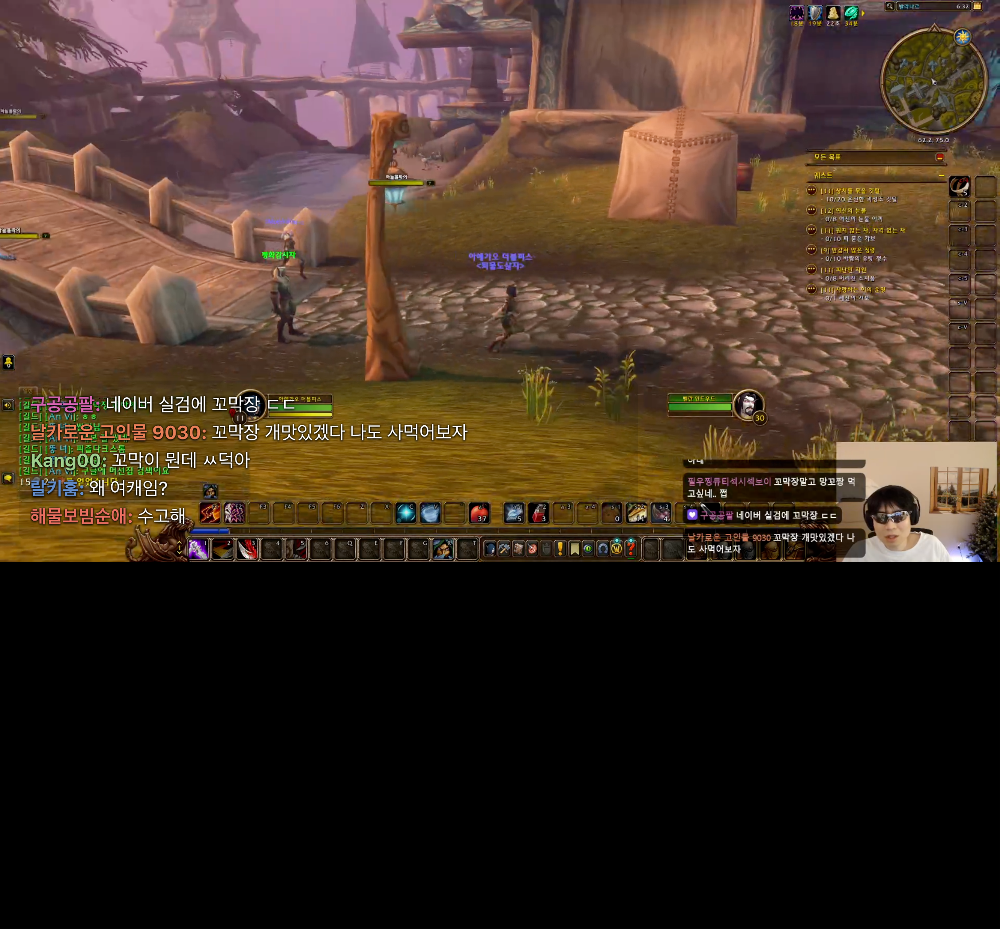
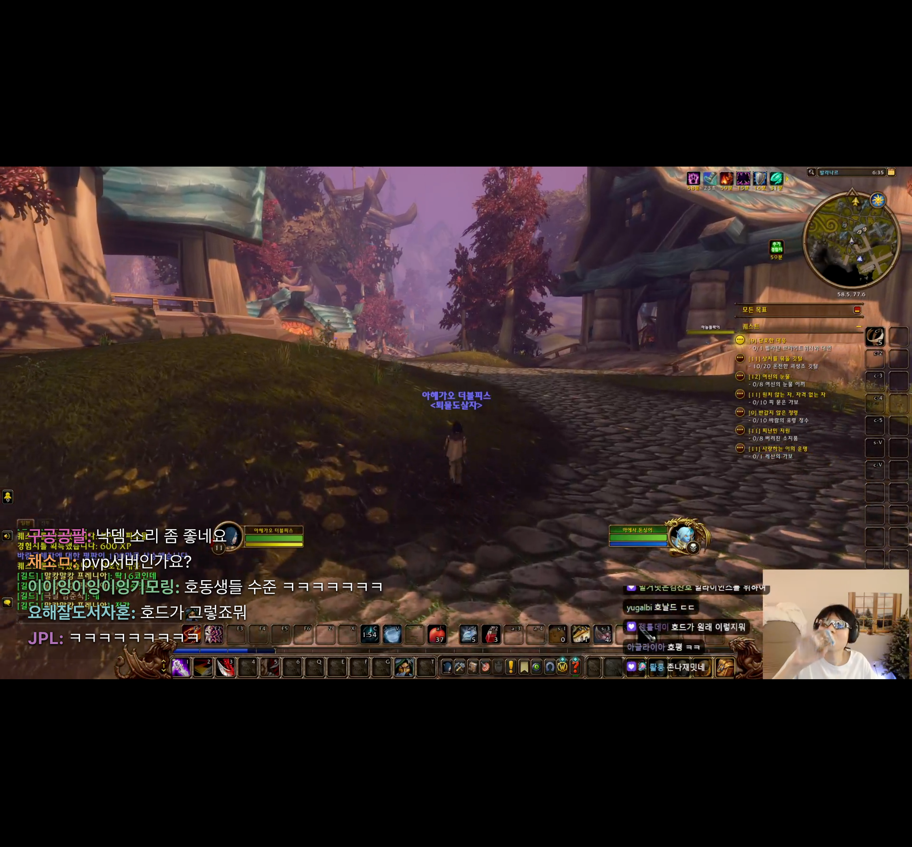

# 폴드 분할 창 전체화면

유튜브를 상단 앱에 유지하고 이지직을 하단 앱에서 전체화면으로 볼 때, 전체화면 플레이어가 현재 이지직 창의 크기를 채우도록 수정했다. 기기 전체 해상도 대신 현재 앱 viewport가 기준이다. 영상 종횡비는 유지하므로 앱 창과 영상 비율이 다르면 정상적인 레터박스는 남는다.

일반 화면의 하단 채팅 배치는 `main`에 채팅 예약 높이와 `max-height: 100vw * 9/16`을 적용한다. 치지직 네이티브 전체화면은 채팅을 포함한 wrapper 자체를 올리므로, 이 규칙이 그대로 남아 플레이어만 일반 화면 높이에 머물렀다. 하단 배치 규칙을 **전체화면 요소와 그 자손에는 적용하지 않도록** 제한했다. 전체화면 종료 시 기존 하단 채팅 배치는 CSS 선택자에 따라 바로 복원된다.

## 실제 방송 참조 뷰포트 검증 (2026-11-05)

전체화면에 진입한 채 창 크기를 순서대로 변경하며 측정했다. 아래 값은 플레이어 박스 높이이며 실제 영상 그림 높이와는 다르다.

| 앱 viewport | 수정 전 플레이어 높이 | 수정 후 플레이어 높이 |
| --- | ---: | ---: |
| 859×450 | 450.0px | 450.0px |
| 859×320 | 320.0px | 320.0px |
| 411×440 | 231.0px | 440.0px |
| 859×798 | 483.2px | 798.0px |
| 859×450 | 450.0px | 450.0px |

| 수정 전: 전체화면 안에 일반 높이 제한 잔류 | 수정 후: 플레이어가 창 전체를 사용 |
| --- | --- |
|  |  |

## 회귀 검사

별도 모의 영상 스트림을 사용하는 Chromium 검사에서는 앱 viewport와 `screen` 크기를 다르게 설정했다. 분할·커버·펼침 참조 크기 5개에서 플레이어·video 박스가 앱 viewport와 일치하고, 같은 video의 재생·채팅 오버레이가 유지되며, 전체화면 종료 후 하단 채팅 배치가 복원되는지 확인한다. [검사 기록](fold-split-fullscreen-report.json).

```sh
yarn build
node scripts/verify-fold-split-fullscreen.mjs
```

이 검사는 Android 실기기에서 유튜브와 Edge를 동시에 띄운 OS 분할 화면 검증은 아니다. 상단 유튜브 앱이나 OS 분할 비율을 확장에서 변경하지 않는다. [Android 멀티윈도우 문서](https://developer.android.com/develop/ui/views/layout/support-multi-window-mode)의 앱별 창 크기 기준에 맞춰 웹 레이아웃을 검증한다.
