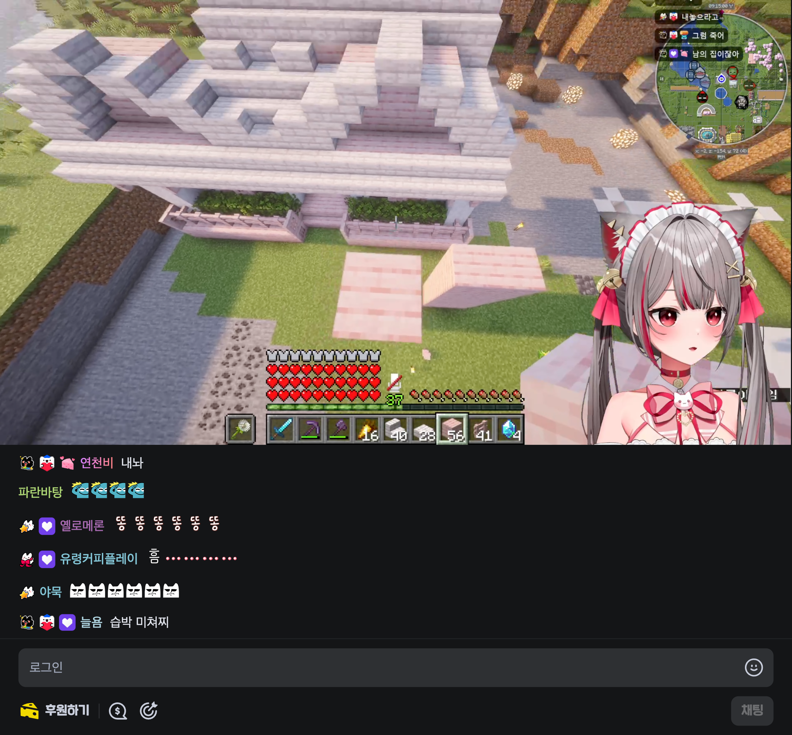
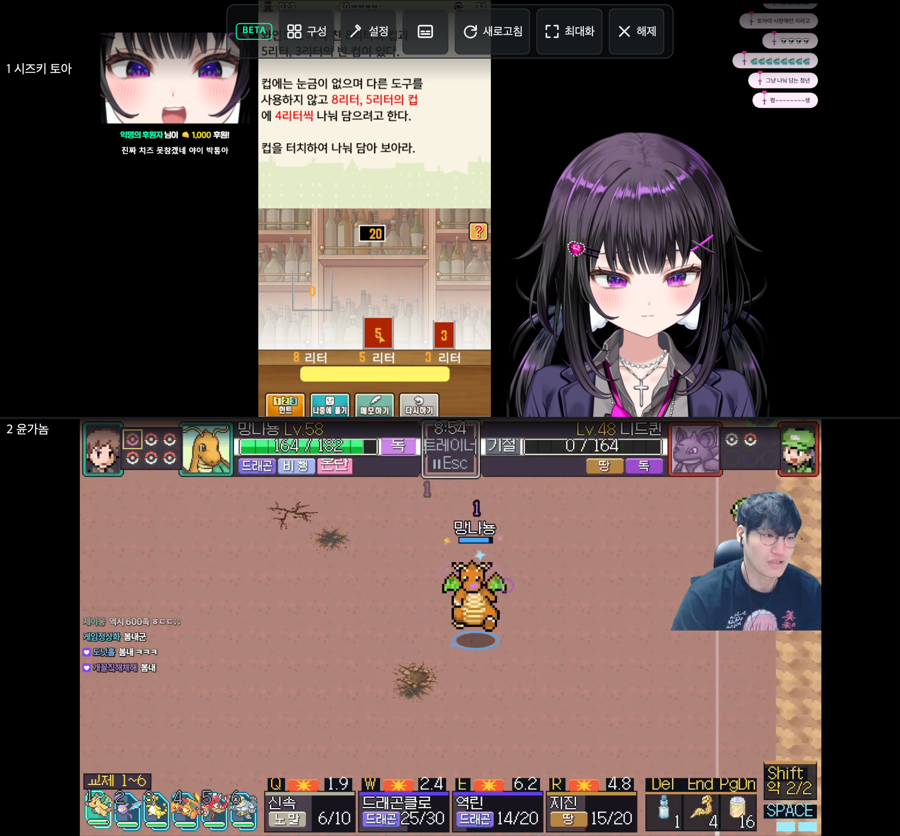
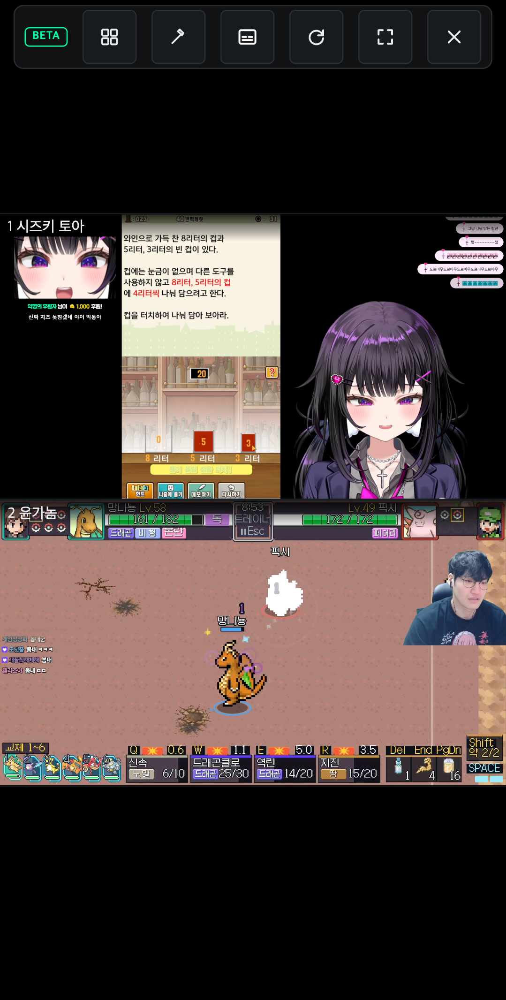
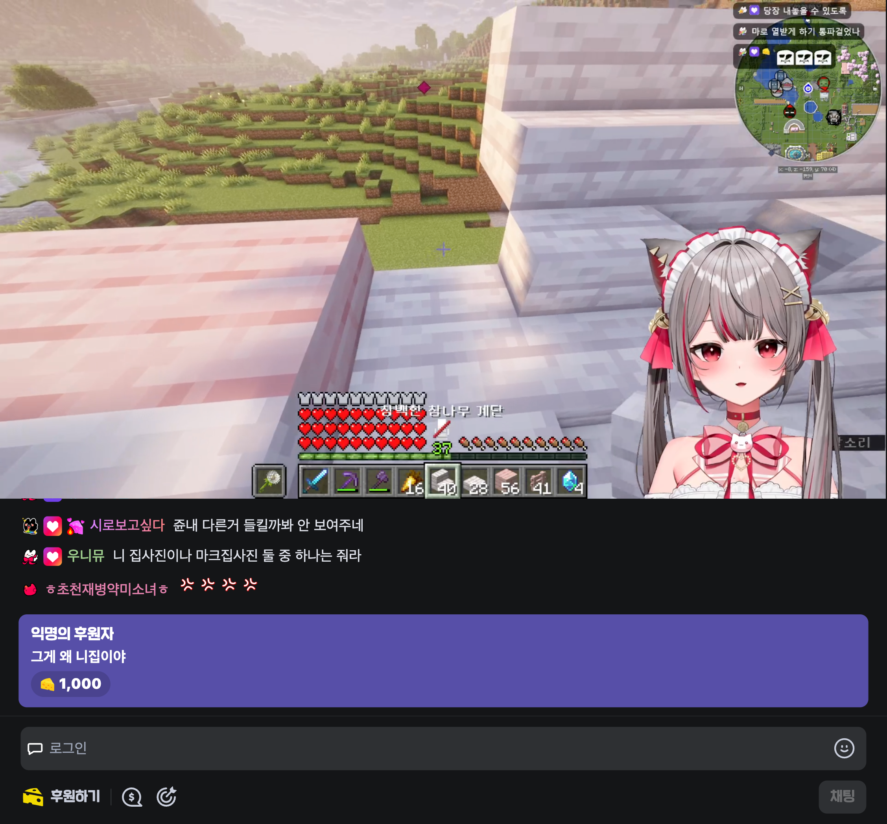
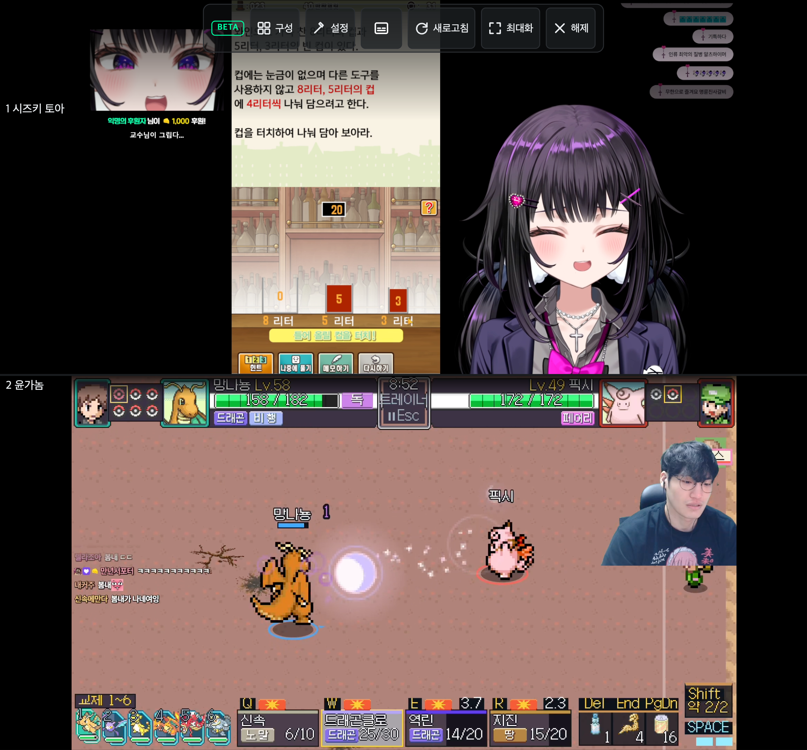

# 폴드 접힘·펼침 전환

추가 사용자 보고의 **저장된 수동 높이에서 남는 빈 공간**은 [별도 재현·수정 기록](fold-manual-height.md)에서 확인할 수 있다. 아래는 최초 자동 설정 전환 검증 기록이다.

첨부 화면의 비율을 참고해 **859×798 → 411×812 → 859×798**을 같은 방송 페이지에서 전환했다. 실제 폴드 기기의 센서·OS를 제어한 검증이 아니라 터치 브라우저 뷰포트 에뮬레이션이다.

## 개선 내용

- 접힘·펼침으로 기기 분류가 바뀌어도 열린 설정창·선택 탭과 멀티뷰 무대·iframe을 유지한다. 프로필과 배치만 갱신한다.
- 폭 변경은 다음 프레임에 처리한다. 연속 리사이즈·스크롤 신호로 300ms 디바운스가 계속 밀리던 경로를 막는다.
- 기기 전환 중 채팅 폭·높이 주장을 해제하고 다시 등록하는 중간 스타일을 노출하지 않는다.
- 입력 중이 아닌 창 높이 변경을 키보드로 오판해 레이아웃 갱신을 건너뛰지 않는다.

수정 전 실제 브라우저에서 펼친 상태의 설정창을 열고 접으면 창이 닫히는 현상을 재현했다. 안정화 후의 채팅 높이 자체는 정상이라, 전환 중 갱신 지연과 상태 초기화를 줄이는 데 초점을 맞췄다.

## 검증

2026-10-28 확장을 로드한 Chromium의 실제 치지직 방송에서 확인했다.

- 일반 시청: 같은 video 요소 유지, 영상과 채팅 경계 간격 5px 이내, 채팅 하단이 뷰포트 하단 6px 이내, 입력창 화면 내 유지.
- 설정: 채팅 탭을 열고 접기 → 펼치기 후 설정창과 선택 탭 유지.
- 멀티뷰: 실제 두 방송 재생 확인 후 전환. 동일 무대·iframe 노드와 src 유지, 두 슬롯 모두 뷰포트 안에 배치.
- 타입 검사·빌드·린트·포맷 검사 통과. 테스트 1,294개 통과, 4개 건너뜀.

| 상태 | 일반 시청 | 멀티뷰 |
| --- | --- | --- |
| 펼침 859×798 |  |  |
| 접힘 411×812 |  |  |
| 다시 펼침 859×798 |  |  |

```sh
yarn demo:shots fold-transition,fold-multiview-transition fold8-ultra-browser
```
