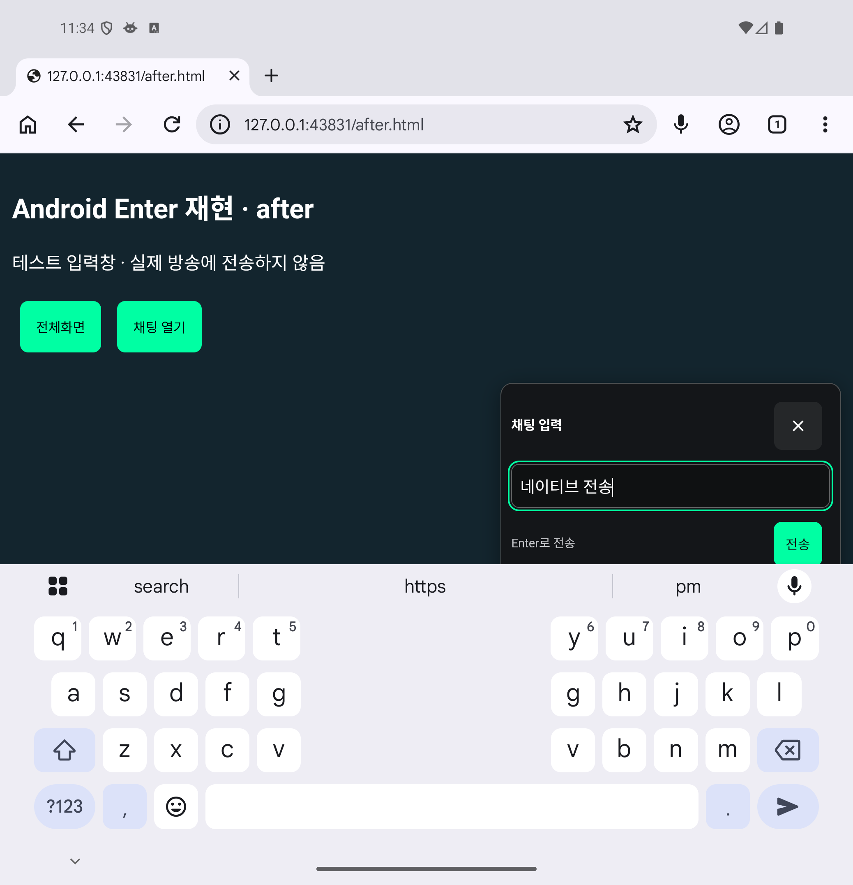

# 전체화면 채팅 입력

라이브 플레이어를 전체화면으로 전환하면 **클립 버튼 바로 왼쪽**에 말풍선 모양의 채팅 버튼이 나타난다. 자막형 채팅 오버레이 오른쪽 아래의 말풍선으로도 열 수 있다. 버튼을 누르면 우측 하단에 최대 340px 폭의 작은 입력 팝업이 열린다. 원래 치지직 채팅 입력창과 내용을 동기화하며, 원본의 채팅 버튼으로 전송한다. 닫기·전체화면 종료 후에도 원래 입력창에 작성 중인 내용이 남는다.

- 한 줄 입력 후 **전송** 버튼 또는 Enter로 보낸다. Shift+Enter도 전송하며 줄바꿈은 지원하지 않는다. 한글 조합 확정만으로는 전송하지 않는다.
- 빈 입력·원본의 입력/전송 제한·연속 전송 제한을 적용한다. 로그인 및 채팅 권한은 치지직에서 처리한다.
- 별도 채팅 목록을 크게 펼치지 않아 영상이 가려지는 면적을 줄인다. 읽기용 자막형 채팅과 함께 사용할 수 있다.
- 팝업 입력과 버튼 조작이 영상의 재생·전체화면 토글로 전달되지 않게 한다.
- 가상 키보드가 열리면 visual viewport 크기에 맞춰 팝업 위치와 최대 높이를 조정한다.
- 일반 라이브·전체화면과 멀티뷰에서 사용할 수 있다. 멀티뷰에서는 각 오버레이의 말풍선이 해당 방송 채팅방으로 연결된다.
- 원본 채팅 DOM을 옮기거나 내부 채팅 클라이언트의 전송 API·토큰을 읽지 않는다.

[오버레이 버튼 사용 화면과 검증 결과](overlay-chat-compose.md)

## 실제 방송 검증

2026-11-02 치지직의 네이티브 전체화면 버튼으로 진입해 검증했다. 클립 버튼 바로 왼쪽 삽입, 팝업의 전체화면 내부 배치, 원본 입력과 초안 동기화, 닫고 다시 열기, 전체화면 종료 후 정리와 동일 영상의 재생 유지를 확인했다. Space·J 입력 중 재생 유지와 915×220의 낮은 뷰포트에서도 팝업이 화면 안에 배치되는 것을 추가 확인했다. 아래는 로그인하지 않은 실제 방송 캡처이므로 전송 버튼은 원본과 같이 비활성 상태다. 로그인한 사용자의 원본 전송 버튼 연결은 React 제어 입력 회귀 테스트로 검증했다.

| 노트북 1440×900 | 폴드 참조 859×798 | 모바일 가로 참조 915×412 |
| --- | --- | --- |
|  |  |  |

뷰포트는 Chromium headless에서 조정한 참조 크기이며 폴드 실기기·Android 가상 키보드의 실측은 아니다. 실제 방송에는 테스트 채팅을 전송하지 않았다.

```sh
yarn build
node scripts/verify-fullscreen-chat.mjs
```

## Android Enter 보완 (2026-11-14)

기존 코드는 `keydown`의 Enter만 처리했다. Android 가상 키보드는 키 이벤트를 보장하지 않으므로, 줄바꿈 의도를 전달하는 `beforeinput`·`input`도 처리한다. 한 줄 입력과 폼 전송을 사용하며 키보드에 ‘전송’ 동작을 요청한다. 원본의 전송 제한과 한글 조합 보호는 유지한다. [Android 키보드 문서](https://developer.android.com/develop/ui/views/touch-and-input/keyboard-input/commands) · [Input Events 명세](https://www.w3.org/TR/input-events-2/) · [enterkeyhint 명세](https://html.spec.whatwg.org/dev/interaction.html#input-modalities:-the-enterkeyhint-attribute)

Android 16 에뮬레이터의 Chrome 157.0.8103.51에서 키 이벤트 없이 개행을 넣는 경로를 비교했다. 수정 전에는 전송 없이 개행만 남았고, 수정 후에는 마지막 한글까지 한 번 전송하고 입력란을 비웠다. 별도로 Gboard 18.5의 화면 키보드 ‘전송’ 키를 직접 눌러 같은 동작을 확인했다. 아래 화면은 실제 소스를 번들한 로컬 테스트 입력창이며, 실제 방송으로 전송하지 않았다. 삼성 키보드·Edge 실기기 검증은 아니다.



[키 이벤트 없는 경로 비교](android-chat-enter-no-keydown-report.json) · [Gboard 전송 키 결과](android-chat-enter-native-report.json)

단위·통합 테스트로 Enter·Shift+Enter·폼 전송, 한글 조합, 취소 불가능한 입력, 중복 전송 방지, 원본 제한, 닫은 팝업의 예약 전송 취소, React 제어 입력을 확인한다. 전체 테스트 1,484개 통과, 4개 건너뜀. 빌드·타입 검사·린트·포맷 검사 통과.

```sh
yarn test src/features/fullscreenChat.test.ts
yarn build
node scripts/verify-overlay-chat-compose.mjs
```
