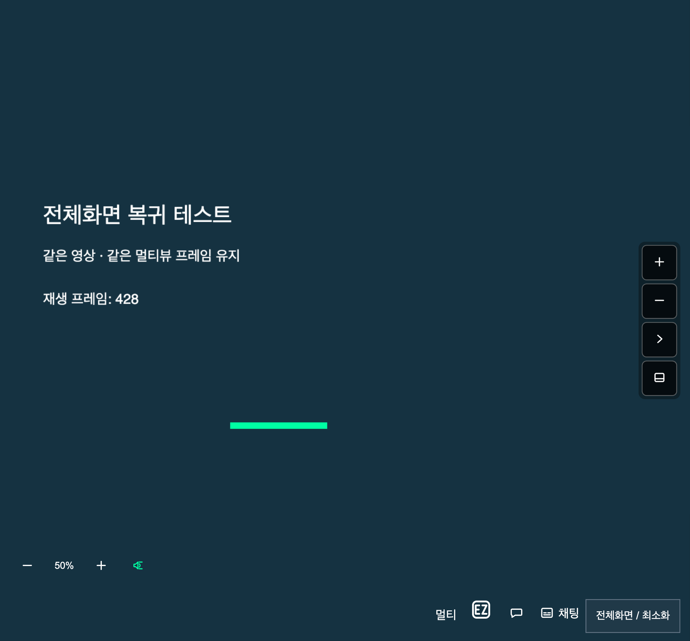
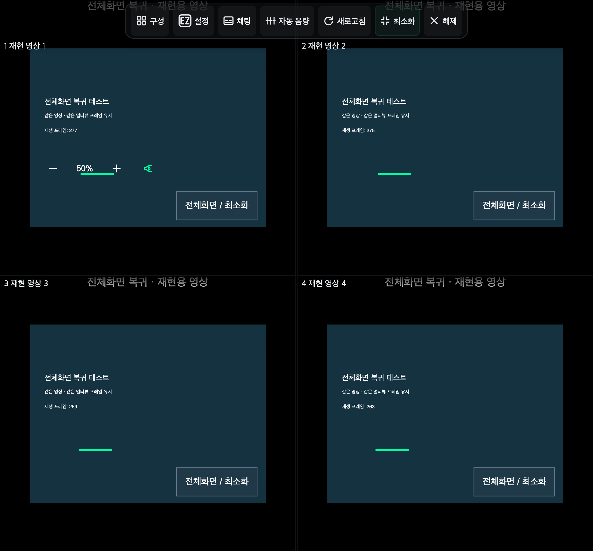

# 앱 복귀 후 전체화면 복원

2026-11-14 갱신. 한 번 전체화면에 들어가면 앱 전환으로 해제되더라도 복귀 때 같은 플레이어로 다시 요청한다. 단일뷰, 멀티뷰 전체, 개별 슬롯에 적용한다. 최소화 버튼·Esc·F·더블 터치·마우스 더블클릭으로 직접 종료하면 복원 의사를 지운다.

이전에는 해제 후 250ms 안에 앱 전환을 감지하지 못하면 복원 의사를 버렸다. 이제 명시적 종료 입력이 없으면 유지하므로, 숨김 이벤트가 늦거나 복귀 포커스 뒤에 해제가 도착해도 복원할 수 있다. PiP로 전환할 때는 재진입을 보류한다.

브라우저가 사용자 입력 없는 요청을 거부하면 반복 요청하지 않고 다음 영상 터치나 재생 키 입력에서 복원한다. [Fullscreen API는 사용자 활성화를 요구할 수 있으므로](https://fullscreen.spec.whatwg.org/#dom-element-requestfullscreen) 모든 모바일 브라우저에서 입력 없는 재진입을 보장하지는 않는다. 페이지 새로고침 뒤까지 전체화면 의사를 저장하지 않는다.

슬롯 입력은 자신을 소유한 멀티뷰 문서에만 중계한다. 개별 슬롯이 전체화면인 경우에는 해당 슬롯이 복원을 맡는다. BFCache에 보관되는 문서의 기능과 복귀 리스너도 유지한다.

## 검증 범위

Node 24.22.2에서 빌드한 확장을 Chromium에 로드하고 859×798 모바일 뷰포트에서 캔버스 영상으로 검증했다. 실방송이나 실물 폴드 기기 촬영이 아니다. 자동화 환경에서는 실제 앱 전환의 숨김 이벤트를 관측하지 못했으므로 `pagehide/pageshow(persisted: true)`를 재생했다. 전체화면 진입·종료 API와 영상 클릭은 실제 브라우저 동작이다.

| 경로 | 확인 결과 |
| --- | --- |
| 단일뷰 자동 복원 | 복귀 뒤 같은 영상으로 전체화면 재진입 |
| 자동 요청 거부 후 영상 클릭 | 단일뷰·멀티뷰 전체·개별 슬롯에서 복원 |
| 해제 뒤 700ms 늦은 앱 전환 | 단일뷰·멀티뷰에서 복원 의사 유지 후 복원 |
| 최소화·Esc 뒤 앱 복귀 | 전체화면으로 강제 재진입하지 않음 |
| 영상·슬롯 유지 | 영상 요소 동일, 재생 시간 진행, 멀티뷰 iframe 동일 |
| 멀티뷰 진입 | 멀티 버튼·스테이지에 BETA 뱃지가 없음 |

요청 거부 경로는 신뢰된 영상 입력이 오기 전까지 자동 요청을 거부하도록 확장 실행 문맥에 주입했다. 실제 Android 권한 정책을 측정한 것은 아니다. CDP의 Esc 입력은 브라우저 UI의 기본 종료가 실행되지 않을 수 있어 이 경우 네이티브 종료 API도 호출한 뒤, 복귀가 재진입을 일으키지 않는지 확인했다. 실제 `visibilitychange`·`blur` 순서, 종료가 숨김보다 먼저 오는 경우, 거부 후 중복 요청 방지와 늦게 승인된 요청 취소는 단위 테스트로 검증했다.

[브라우저 검증 기록](fullscreen-return-report.json), 재현 스크립트: `scripts/verify-fullscreen-return.mjs`.

```sh
yarn test
yarn build
yarn lint
yarn format:check
node scripts/verify-fullscreen-return.mjs
```

브라우저 6개 경로와 단위·통합 테스트 1,479개 통과·4개 건너뜀. 빌드·타입 검사·린트·포맷 검사 통과.

## 복원 후 캡처




