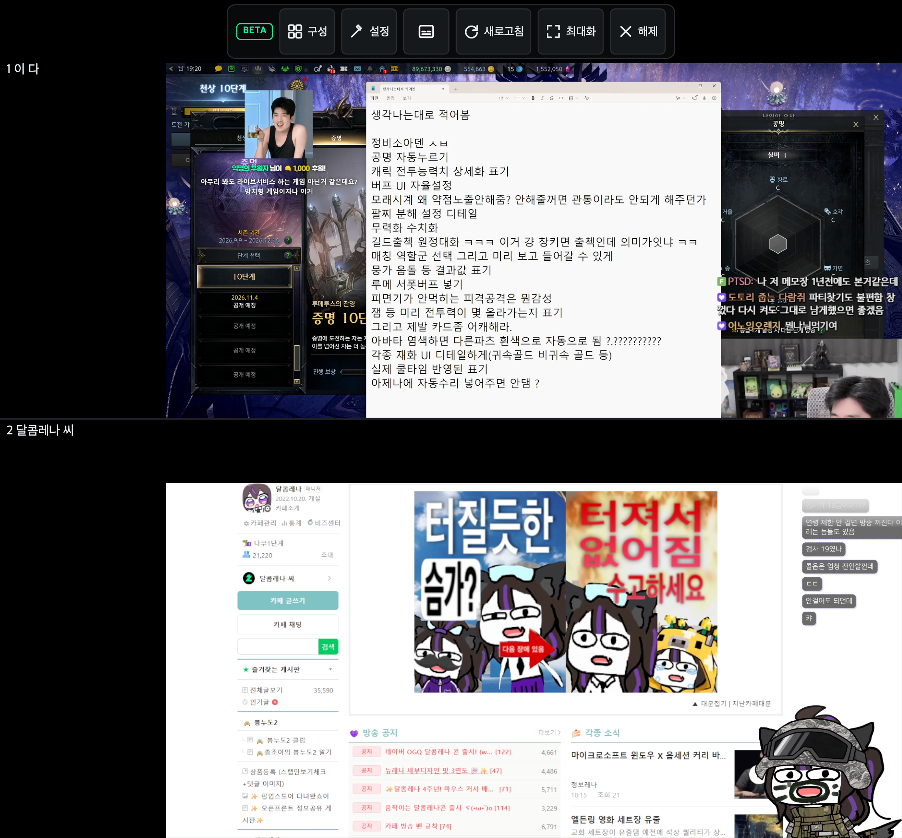
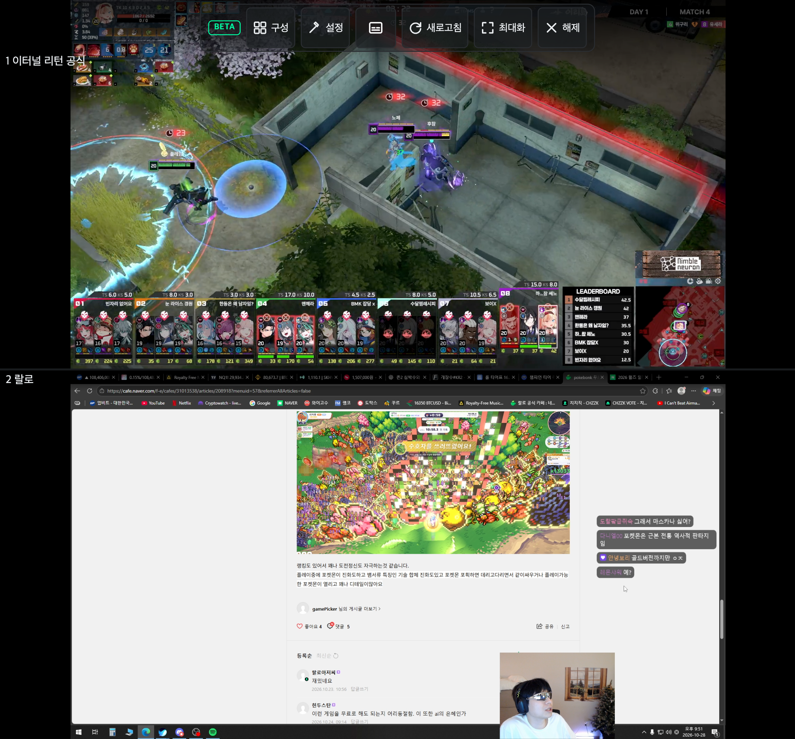
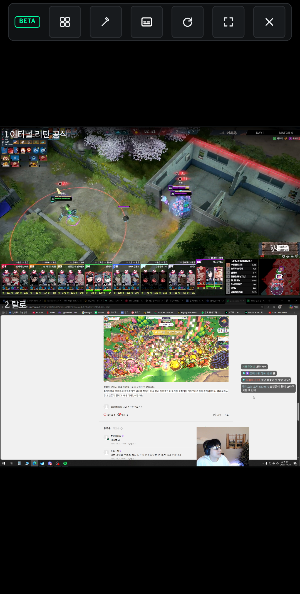
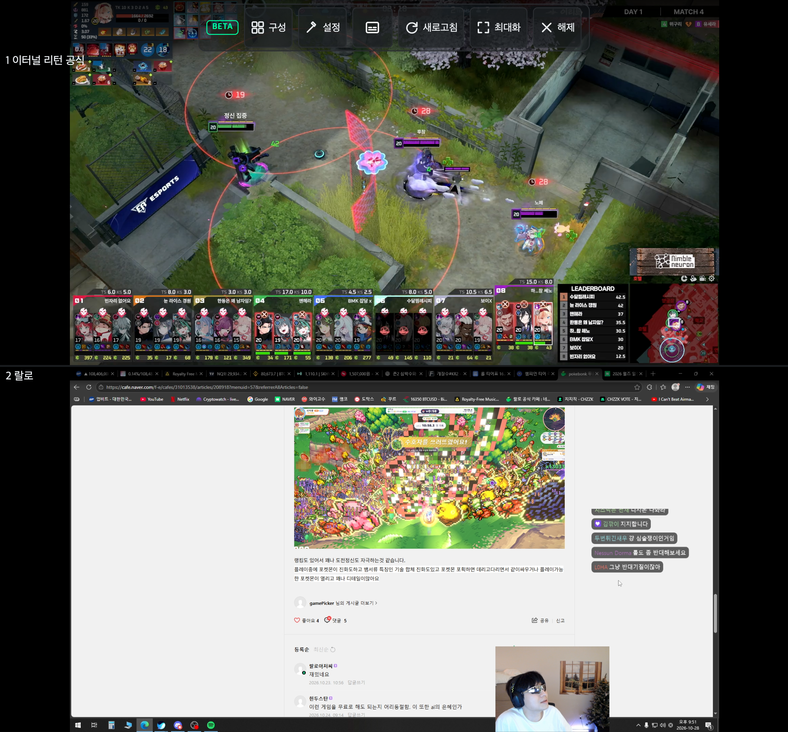
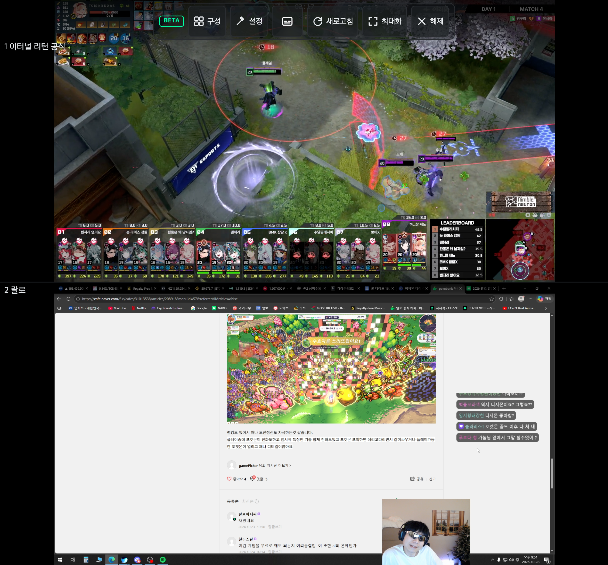
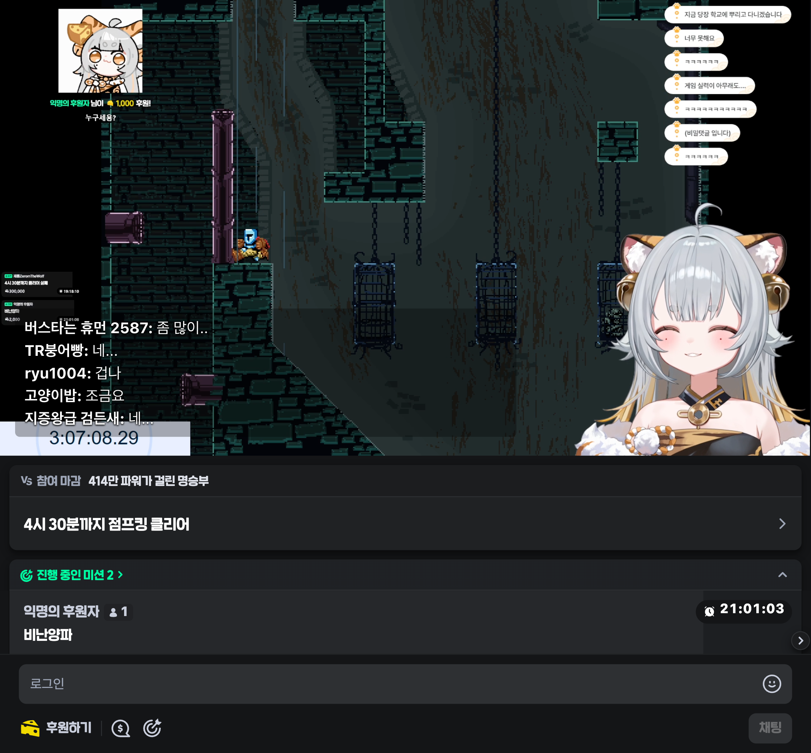
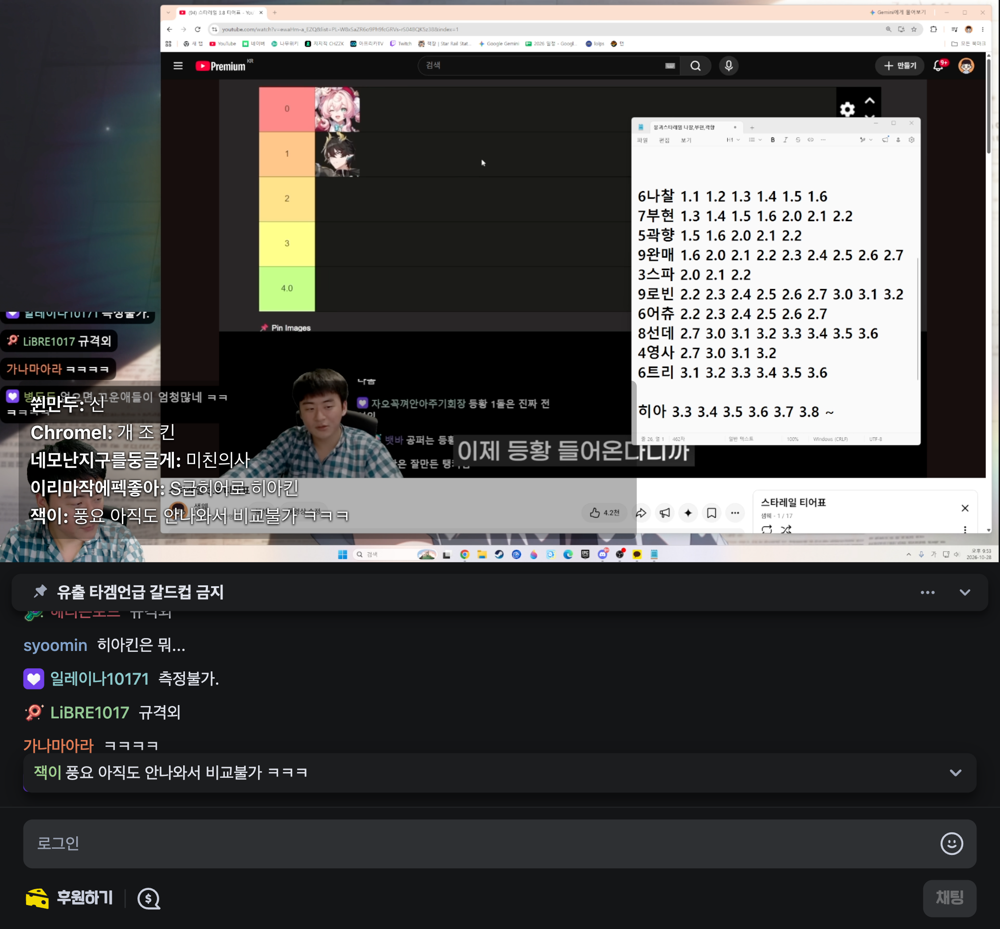
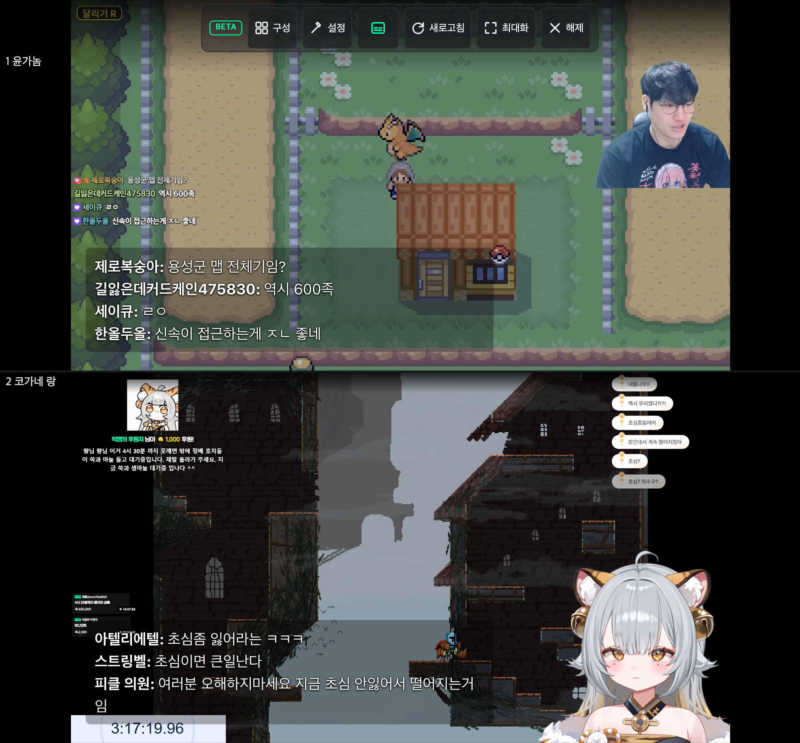

# 멀티뷰 영상 쏠림·채팅 자막 갱신 디버깅

## 영상이 오른쪽으로 밀리는 경우

실제 방송 두 슬롯에서 치지직의 넓은 화면을 해제하면 `#live_player_layout`과 실제 video가 슬롯 원점 대신 **x=82px, y=60px**에 놓였다. 치지직 section의 transform 때문에 fixed 플레이어가 뷰포트가 아닌 상위 레이아웃을 기준으로 배치됐다.

슬롯 모드에서만 플레이어의 실제 조상 transform을 해제한다. 해시 클래스에 의존하거나 플레이어 DOM을 이동하지 않는다. 영상은 contain과 중앙 정렬을 유지한다.

두 슬롯 각각에서 펼침·네이티브 좁은 화면·접힘·재펼침·네이티브 넓은 화면·최대화·최대화 해제의 7개 상태를 검사했다. 플레이어·내부 루트·video 모두 x/y=0, 슬롯 전체 크기와 일치하며 동일 video 요소를 유지했다.

| 수정 전 좁은 화면 | 수정 후 좁은 화면 |
| --- | --- |
|  |  |

| 접힘 | 최대화 | 최대화 해제 |
| --- | --- | --- |
|  |  |  |

## 예전 채팅만 남는 경우

원본 채팅을 과거 메시지 위치로 스크롤하면 오버레이도 과거 채팅에 고정되는 현상을 재현했다. 페이지 내부 최신 메시지 목록은 계속 갱신되지만 확장의 격리된 실행 환경에서는 React 데이터에 접근할 수 없어, 원본 화면에 남은 DOM만 읽는 경로로 동작했다.

오버레이가 켜진 프레임에서 페이지 실행 환경의 읽기 전용 소스를 사용한다. 최신 목록의 닉네임·본문 최대 6개만 확장으로 전달하고 일반 텍스트로 표시한다. 원본 채팅의 스크롤·입력은 변경하지 않는다. 원본 DOM 변경 감지와 1초 주기로 갱신하며 해제 시 구독을 정리한다. 요청 프레임·경로·세션을 대조해 이전 방송의 응답을 적용하지 않는다. 추가 확장 권한이나 별도 네트워크 연결은 사용하지 않는다.

최신 목록이 비면 예전 메시지를 다시 표시하지 않고 비운다. 네이티브가 React 노드로 변환한 이모티콘도 표시용 텍스트만 추출한다. 소스가 준비되지 않은 동안에는 기존 DOM 방식으로 표시한다.

| 수정 전 과거 채팅 위치 | 수정 후 최신 자막 | 두 슬롯의 최신 자막 |
| --- | --- | --- |
|  |  |  |

일반 시청과 실제 방송 두 슬롯에서 원본 채팅을 과거 위치에 둔 채, 소스의 더 새로운 메시지가 자막에 **각 3회 연속** 반영되는 것을 확인했다. 원본 스크롤이 과거 위치로 유지되는 것도 함께 검사했다.

## 재현

```sh
yarn demo:shots multiview-alignment,chat-subtitle-freshness,chat-subtitle-freshness-multiview fold8-mobile-browser
yarn demo:shots fold-responsive fold8-mobile-browser
```

Chromium 모바일 뷰포트 에뮬레이션으로 실제 방송에서 검증했다. 물리 폴드의 Edge를 직접 조작한 검증은 아니다.

최종 빌드·타입 검사·린트·포맷 검사 통과. 테스트 50개 파일, 1,302개 통과 / 4개 건너뜀. 최신 소스를 적용한 상태에서 기존 7개 접힘·펼침 상태, 같은 video/자막/컨트롤과 음량·음소거·사용자 일시정지 유지도 재검증했다.
