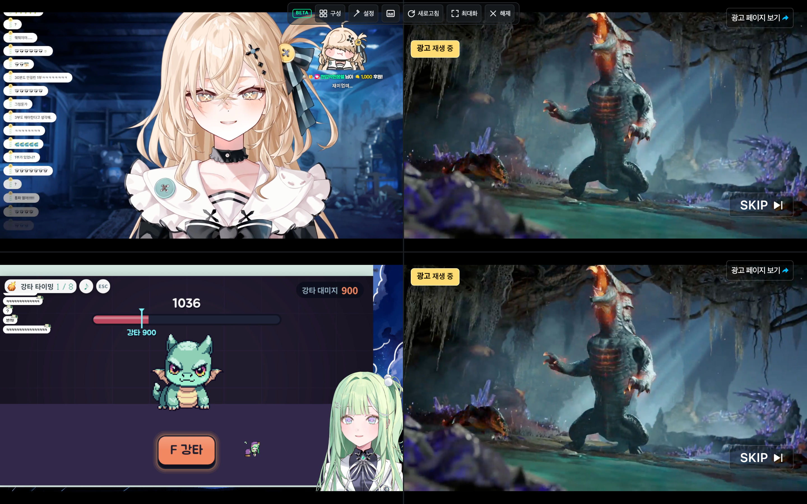

# 멀티뷰 광고 상태 표시

광고가 감지된 슬롯 왼쪽 상단에 노란색 **광고 재생 중** 배지를 표시한다. 광고 중에는 본방송 재생 실패 안내를 숨기고, 광고가 끝나면 배지를 지운 뒤 본방송의 재생 상태를 다시 확인한다. 다른 슬롯의 실제 실패 안내는 독립적으로 유지한다.

본방송 컨테이너(`#live_player_layout`)가 만들어지기 전에 별도 광고 플레이어(`.vod_player_wrap`)가 표시되는 프리롤도 감지한다. 슬롯 모드에서 이 광고 플레이어를 본방송 바깥 UI와 함께 숨기지 않도록 보완했다. 광고 플레이어가 직접 숨긴 자손 요소나 스킵 버튼의 노출 시점은 변경하지 않는다. 광고 차단·네트워크 요청 수정 기능이 아니다.

실제 4분할 방송에서 두 슬롯의 프리롤 광고와 노란 배지를 확인했고, 광고 종료 후 본방송으로 전환되면서 배지가 사라지는 것을 기록했다. 아래 이미지는 실제 방송·광고 캡처다. 스킵 버튼 자동 클릭은 감지 관찰을 위해 꺼 둔 상태다. 광고 표시는 이 설정을 꺼도 동작한다.



브라우저 회귀 검사는 별도의 모의 광고 마크업으로 광고 시작·지속·종료, 오류 안내 제거, 광고 종료 후 본방송 대기, 다른 슬롯의 실제 실패 유지까지 확인한다.

```sh
yarn build
node scripts/verify-multiview-ads.mjs
```
