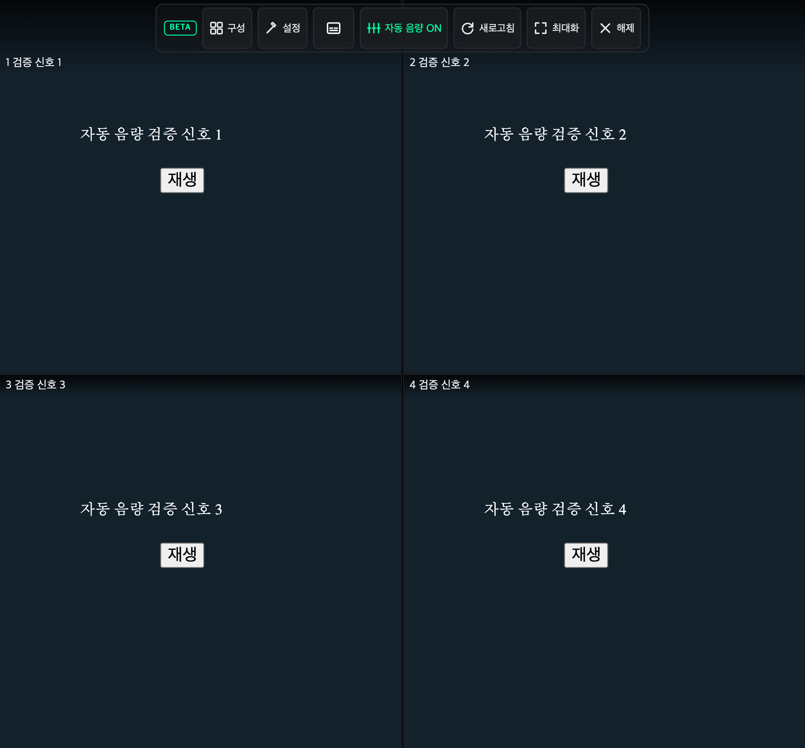

# 멀티뷰 자동 음량

멀티뷰 상단 바의 **자동 음량 ON/OFF** 버튼으로 모든 슬롯의 실시간 음량 보정을 켜고 끈다. 기본값은 **OFF**이며 선택은 저장된다. 설정 → 멀티뷰의 **멀티뷰 자동 음량**에서도 바꿀 수 있다. 버튼 툴팁에서 조정 중인 방송 수나 측정 불가 상태를 확인할 수 있다.

각 슬롯의 Web Audio 파형에서 RMS를 측정해 수동 음량 배율을 제외한 동일한 기준(RMS 0.08, 약 −22dBFS)으로 보정한다. 수동 음량은 보정 계산에서 분리해 사용자가 낮춘 음량을 다시 키워 상쇄하지 않는다. 250ms 간격으로 측정하고 약 1초 평균을 사용한다. 음량을 줄일 때는 빠르게, 올릴 때는 천천히 변하도록 하며, 무음·음소거·정지 구간은 증폭하지 않는다. 긴 무음·정지 후에는 이전 증폭값을 남기지 않는다. 최대 8배 및 측정 피크에 따른 상한을 적용하므로 극도로 작은 소리는 목표에 도달하지 않을 수 있다. RMS 기반이므로 음악·목소리의 체감 음량을 완전히 동일하게 보장하는 LUFS 정규화는 아니다.

기존 요소별 오디오 그래프를 재사용한다. 기존 컴프레서·수동 게인 뒤에 측정기와 보정 게인을 연결하며, 수동 음량 값·음소거·컴프레서 설정을 변경하지 않는다. OFF 시 보정 게인만 1로 부드럽게 복귀하고 측정 타이머를 정리한다. 영상 교체·광고 영상·늦게 준비된 슬롯에도 적용한다. 오디오는 슬롯 안에서 처리하며 녹음하거나 서버로 보내지 않는다.

파형 측정은 [AnalyserNode.getFloatTimeDomainData](https://developer.mozilla.org/en-US/docs/Web/API/AnalyserNode/getFloatTimeDomainData), 점진적 게인 변경은 [AudioParam.setTargetAtTime](https://developer.mozilla.org/en-US/docs/Web/API/AudioParam/setTargetAtTime)을 사용한다.

## Chromium 검증 (2026-11-05)

실제 방송 대신 진폭이 2배씩 다른 4개 WAV 신호를 슬롯에서 동시에 재생했다. 확장 실행 환경의 기존 Web Audio 출력에 검사 전용 분석기를 연결해 실제 출력 RMS를 읽었다. 브라우저 자동재생 정책은 사용자 동작을 요구하도록 설정했고 각 슬롯을 클릭해 재생했다. 테스트 음향은 시스템 출력에서 음소거했다.

| 조건 | 슬롯 간 출력 차이 |
| --- | ---: |
| 자동 보정 OFF | 18.04dB |
| 자동 보정 ON, 8초 후 | 0.03dB |
| 기존 컴프레서 ON·수동 음량 50% | 0.02dB |

추가로 반복 토글 시 소스 재사용, video 교체 후 처리 재연결, 무음 및 이후 재생 시 보정 복구, OFF 시 원래 음량·컴프레서 유지, 411px 모바일 조작 바의 화면 내 배치를 확인했다. 위 수치는 합성 신호의 결과이며 실제 방송·실기기의 동일 결과를 의미하지 않는다. [측정 기록](multiview-auto-volume-report.json).



```sh
yarn build
node scripts/verify-multiview-auto-volume.mjs
```
