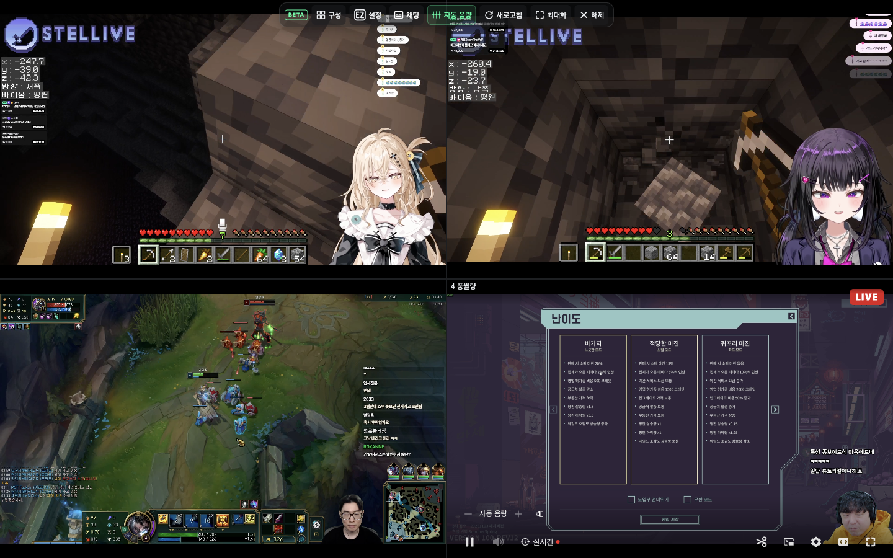
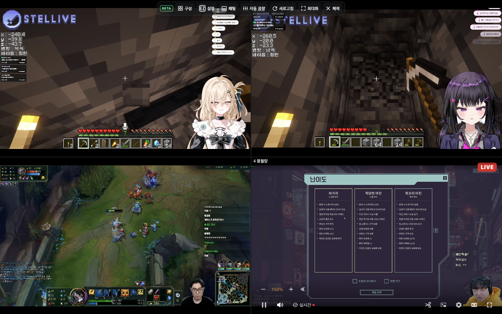
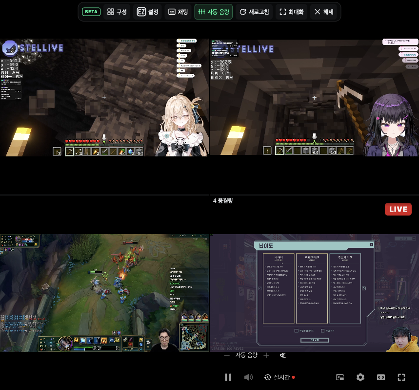

# 멀티뷰 자동 음량 잠금과 복원

2026-11-06. 자동 음량을 켜면 모든 슬롯의 수동 볼륨을 100%로 고정하고 음소거를 해제한다. 화면에는 숫자 대신 **자동 음량**을 표시한다. 확장 볼륨 버튼, 치지직 볼륨 버튼·슬라이더, 음량 단축키를 차단한다. 플레이어가 볼륨을 다시 변경해도 100%로 되돌린다.

실제 출력은 별도의 자동 보정 게인이 조절한다. 재생 중인 방송의 약 1초 RMS 평균을 모아 공통 목표를 계산한다. 무음·일시정지·측정 불가 방송은 평균에서 제외하고, 과도한 증폭과 혼합 출력 증가를 줄이기 위해 목표 RMS를 0.02~0.08로 제한한다. 측정·보정 주기는 250ms이며 갑자기 커지는 소리는 기존 피크 제한으로 처리한다. RMS 기준이므로 음악과 대화의 체감 음량을 완전히 동일하게 보장하지는 않는다.

끄면 켜기 직전 방송별 볼륨과 음소거를 복원한다. 100% 초과 증폭도 복원한다. 임시 100%는 방송별 기억값이나 확장의 마지막 볼륨을 덮어쓰지 않는다. 복원값은 방송별 세션 저장소에도 보관해 iframe 재접속·볼륨 기능 재시작 중에도 유지한다.

## 검증

Chromium에 빌드한 확장을 로드하고 서로 다른 진폭의 WAV 4개를 실제 슬롯에서 동시에 재생했다. 자동재생은 사용자 동작을 요구하도록 설정했다. Web Audio의 최종 출력 분석기로 RMS·피크를 읽었으며, 아래 정량 음량 수치를 실방송이나 실물 폴드 기기 측정으로 해석하지 않는다.

- 시작값 30%·50%·80%·150%, 2번 방송 음소거 → ON에서 모두 100%·음소거 해제 → OFF에서 원래 값 복원
- 버튼 클릭, 음량 키, 직접 `volumechange`로 수동 변경을 시도해도 잠금 유지
- 작은 신호 4개의 공통 평균 목표 RMS 약 0.0265로 수렴
- 일시정지·재개, 무음 후 복구, 영상 요소 교체, 반복 토글, 기존 컴프레서 병용
- ON에서 iframe 재접속 후 100% 유지, OFF에서 재접속 전 30% 복원
- 모바일 폭 411px에서 상단 조작 바 화면 내 배치

| 조건 | 측정 결과 |
| --- | --- |
| 서로 다른 음량의 신호 4개, 자동 음량 ON | 출력 차이 0.025dB |
| 작은 신호 4개의 평균 목표 | RMS 0.02652 |
| 작은 신호 4개의 보정 출력 | RMS 약 0.0262~0.0267 |
| 작은 소리 직후 큰 소리 | 최대 피크 0.6152 |
| 기존 컴프레서 병용 | 슬롯 간 출력 차이 0.04dB 미만 |

정량 결과는 [WAV 브라우저 측정 기록](multiview-volume-lock-report.json)에 있다.

## 2026-11-07 스크린샷 갱신

표시 변경 커밋 `dd63f3a`를 빌드하고, Claude의 `agent-browser` 스킬에 따라 전용 Chrome 프로필에서 실제 방송 4개를 재생해 촬영했다. 광고가 끝나고 모든 영상의 재생 시계가 진행하는 것을 확인했다. 촬영 탭의 오디오는 탭 수준에서 음소거해 시스템 출력에 영향을 주지 않았다.

- **자동 음량 ON:** 4개 슬롯 모두 “자동 음량” 표시·음소거 해제·볼륨 버튼 비활성화. 내부 입력 볼륨은 100% 유지
- **859×798 뷰포트 전환:** 영상 재생과 “자동 음량” 표시·잠금 유지
- **자동 음량 OFF:** 30%·50%·80%·150%로 복원, 수동 볼륨 버튼 활성화

캡처는 데스크톱 1440×900과 좁은 859×798 브라우저 뷰포트 기준이다. 추가로 411×900에서 4개 슬롯의 “자동 음량” 문구가 잘리거나 줄바꿈되지 않는 것을 확인했다. 실물 폴드 기기를 촬영한 것은 아니다. 네이티브 컨트롤바는 포인터가 있는 슬롯에 표시되며, 4개 슬롯의 검증 상태는 [실방송 캡처 기록](multiview-volume-lock-capture.json)에 남겼다. 방송 영상 위에 검증용 표시를 덧씌우지 않았다.







CI 실패는 jsdom의 `sessionStorage` 변경 이벤트를 타이머 누수로 잘못 세던 검사 때문이었다. 이벤트를 전달한 뒤 반복 타이머가 남는지 검사하도록 수정했으며, [해당 수정의 GitHub CI](https://github.com/Arc-Jung/ezzzk/actions/runs/42365599124)는 통과했다. 현재 Node 24.22.2에서도 아래 검사를 통과했다.

```sh
yarn test
yarn build
yarn lint
yarn format:check
node scripts/verify-multiview-auto-volume.mjs
```

단위 테스트 1,394개 통과·4개 건너뜀. 빌드·린트·포맷 검사 통과.
