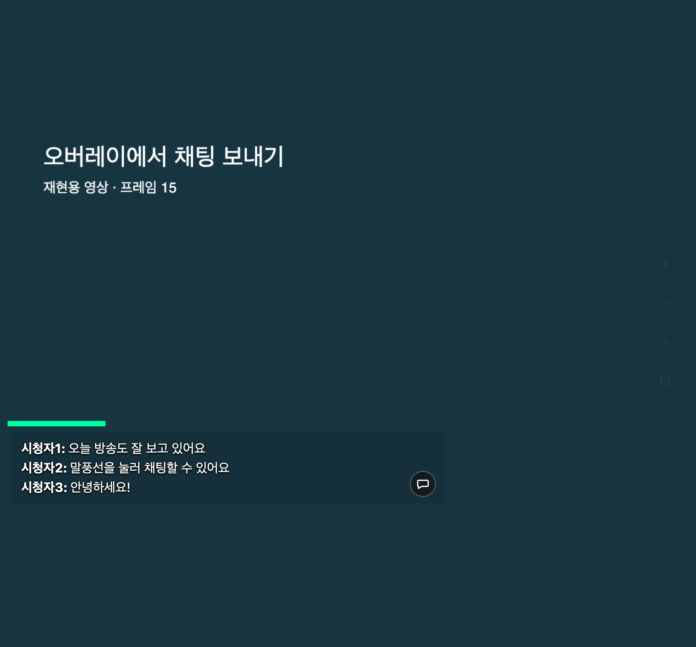
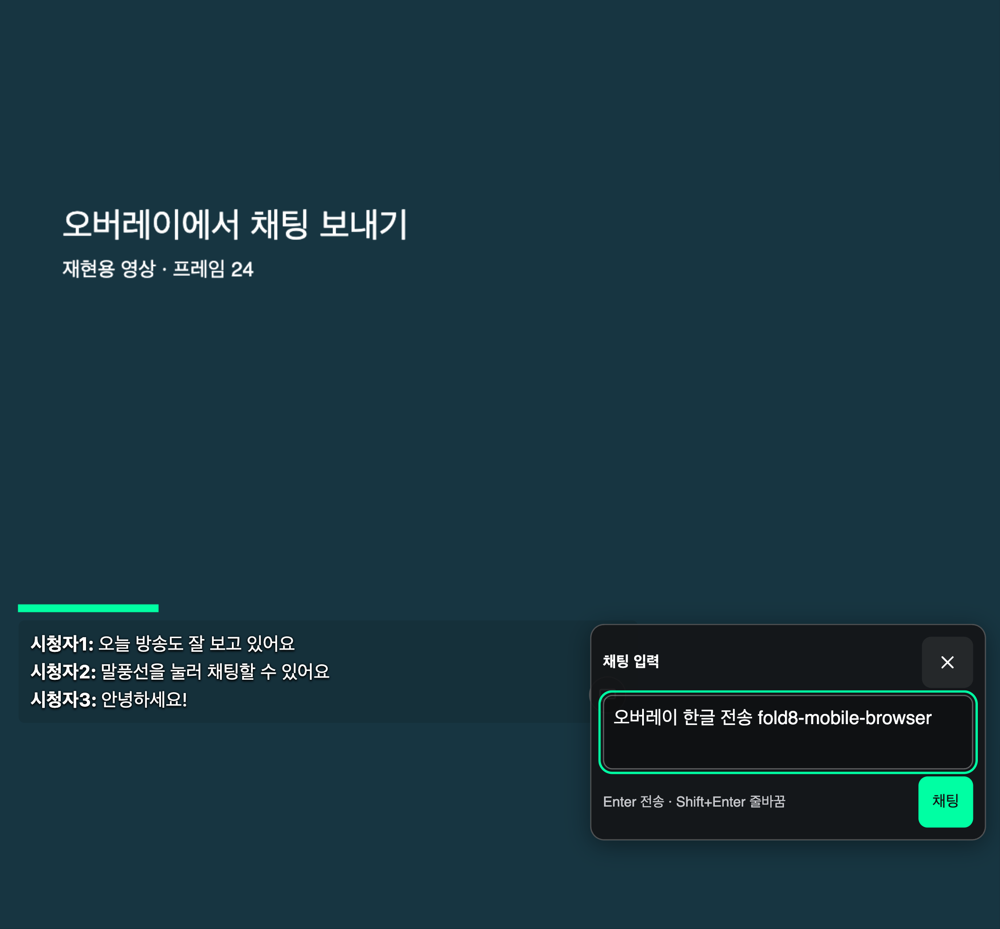
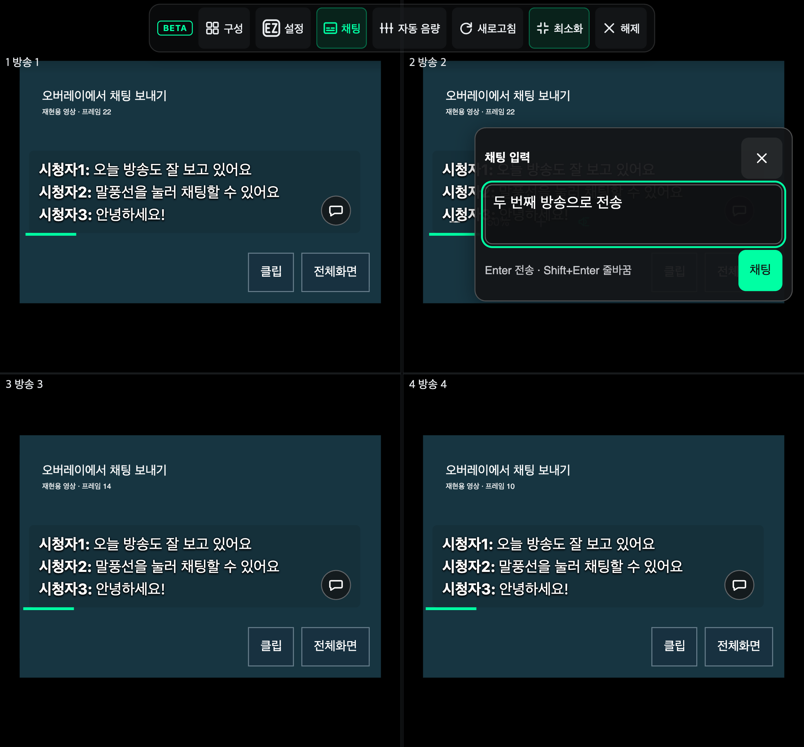

# 오버레이에서 채팅 보내기

자막형 채팅 오른쪽 아래의 **말풍선**을 누르면 작은 입력창이 열린다. 내용을 입력한 뒤 **채팅** 버튼이나 Enter로 전송한다. Shift+Enter는 줄바꿈이다.

전체화면에서도 사용할 수 있다. 멀티뷰에서는 누른 방송의 채팅방으로 전송한다. 아직 메시지가 없어도 말풍선은 남으며, 입력 권한·로그인·전송 제한은 원래 치지직 채팅과 같다.

## 화면

글을 가리지 않는 작은 말풍선:

말풍선을 눌러 연 입력창:

멀티뷰 두 번째 방송의 채팅 입력창:

## 검증

- 모바일·태블릿 가로/세로, 노트북, 폴드 참조 화면에서 입력·전송·입력란 비우기·닫기와 초점 복원 확인.
- 영상 컨트롤바가 숨겨져도 버튼을 누를 수 있고, 버튼의 터치 영역은 44×44px이며 글과 겹치지 않음.
- 멀티뷰에서 다른 방송에는 보내지 않고 선택한 방송에만 한 번 전송. 전체화면과 재생 유지.
- 메시지가 없는 상태에서도 입력창을 열 수 있음.

[8개 브라우저 경로의 결과](overlay-compose-report.json) · [검증 스크립트](../scripts/verify-overlay-chat-compose.mjs)

Node 24.22.2, Chromium 151.0.7922.34에서 빌드한 확장과 재현용 영상·채팅 DOM으로 확인했다. 전송은 로컬 테스트 입력·버튼으로 검증했으며 실제 방송에 메시지를 보내지 않았다. Android 실기기의 가상 키보드 동작은 이 결과에 포함하지 않는다.
