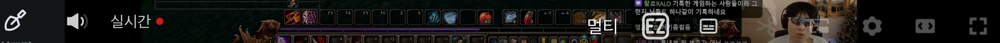
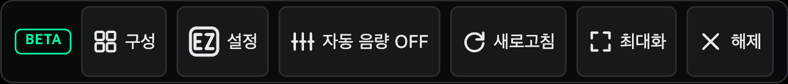

# 이지직 전용 설정 아이콘

치지직의 기본 톱니바퀴와 구별되도록 둥근 사각형 안에 `EZ`를 넣은 인라인 SVG를 사용한다. 싱글뷰의 톱니바퀴·배지와 멀티뷰의 망치를 같은 SVG로 교체했다.

- 싱글뷰: 24px SVG, `이지직 설정` 툴팁.
- 멀티뷰: 20px SVG와 `설정` 글자, `이지직 설정 열기` 툴팁.
- 두 화면이 같은 SVG 형상을 공유하고 주변 버튼과 같은 색상을 사용한다.

## 실제 화면

싱글뷰 컨트롤바. EZ 아이콘과 오른쪽의 치지직 기본 톱니바퀴가 구별된다.

멀티뷰 상단 바.

## 검증

`node scripts/verify-settings-icon.mjs`로 공개 생방송에서 두 아이콘의 SVG 형상이 같은지 확인하고, 각 버튼으로 설정 창을 열고 닫았다. 터치 프로필에서 싱글뷰 버튼은 44×44px이고 411px 화면의 멀티뷰 버튼도 44×44px이며 화면 밖으로 나가지 않는다.

스크린샷은 Chromium 터치 프로필에서 실제 컨트롤바를 캡처했다. 실물 폴드 기기 검증은 포함하지 않는다.

`yarn test` 1,384개 통과·4개 건너뜀, `yarn build`, `yarn lint`, `yarn format:check` 통과.
