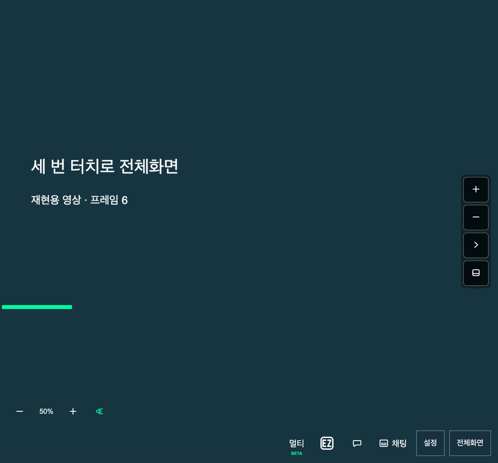
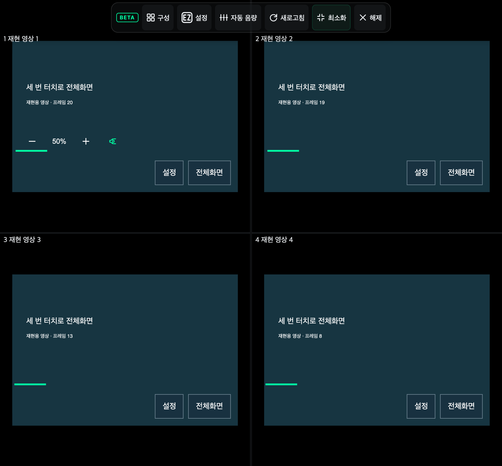
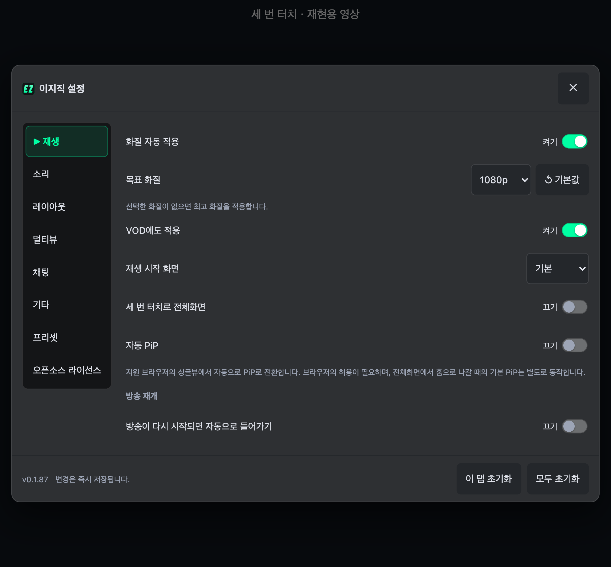

# 세 번 터치로 전체화면

이 문서는 v0.1.88의 검증 기록이다. 현재 기능은 [더블 클릭으로 전체화면](double-tap-fullscreen.md)으로 변경됐다.

영상의 같은 곳을 빠르게 세 번 누르면 전체화면을 켜거나 끈다. 멀티뷰에서는 슬롯 하나가 아닌 전체 무대가 전환된다. **설정 → 재생 → 세 번 터치로 전체화면** 또는 확장 팝업에서 켜고 끌 수 있다(기본 켜짐).

## 검증

- 모바일·태블릿 가로/세로, 폴드 참조 뷰포트에서 세 번째 터치에 진입하고 다음 세 번 터치로 종료.
- 설정을 끄면 즉시 전환 중단, 다시 켜면 새로고침 없이 재개. 멀티뷰 슬롯에도 반영.
- 두 번 터치, 느린 터치, 설정 버튼 조작은 전환하지 않음. 페이지 확대 없음.
- 멀티뷰 첫 번째 방송에서 진입하고 두 번째 방송에서 종료. 기존 iframe 유지, 최소화 버튼 상태 반영.
- 모바일 웹 플레이어에서도 진입·종료 확인. 노트북의 마우스 더블클릭 유지.
- 직접 종료한 뒤 pagehide/pageshow를 재현해도 전체화면이 복원되지 않음.

Node 24.22.2, Chromium 151.0.7922.34와 빌드한 확장을 사용했다. 실제 터치 입력과 Fullscreen API로 검증했으며, 영상은 canvas 재현용이다. Android 실기기의 OS 전체화면 동작을 검증한 결과는 아니다.

[전체 10개 브라우저 검증 결과](triple-tap-fullscreen-report.json) · [재현 스크립트](https://github.com/Arc-Jung/ezzzk/blob/v0.1.88/scripts/verify-triple-tap-fullscreen.mjs)

## 화면

싱글뷰에서 세 번 터치한 뒤:

멀티뷰에서 세 번 터치한 뒤:

설정에서 끈 상태:

